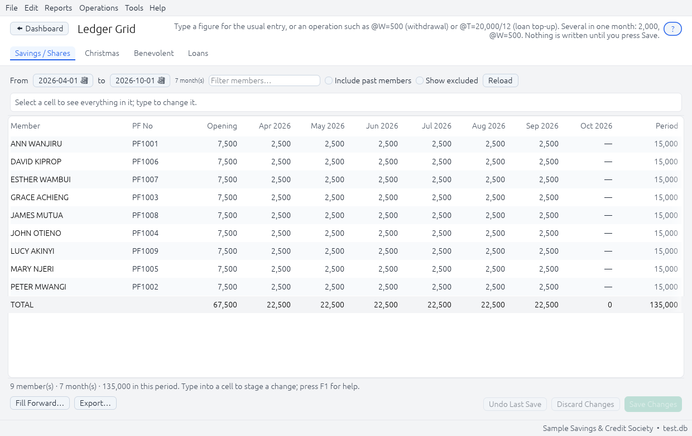

# LoanMaster

[](https://github.com/Eric13587/loanmaster-sacco/actions/workflows/ci.yml)

Built for the Kabete Welfare Staff Association at Nairobi Water to manage
member loans, savings, and welfare funds.

Desktop loan, savings and fund management for SACCOs (savings and credit
cooperatives). Written in Rust with egui and SQLite; runs fully offline with a
single-file "journal" database that can live on a shared drive.

See the [migration notes](docs/rust-migration.md) for journal compatibility,
validation, and workflow changes from 1.x. The Ledger Grid replaces the old
mass operations. The general ledger and journal repair tools were removed.



*LoanMaster 2.0 Ledger Grid with demo data.*

## Office workflows (feature branch)

- **Reports › Document builder** exports a selected dataset to PDF or Excel. Choose and reorder fields, edit the letterhead, title and subtitle, and toggle the journal logo (the default is `kaswa_n.png`). Member financial overview combines roster, loan and savings balances in one row per member. Transaction datasets retain one row per posting.
- **Email drafts** open in classic Outlook on Windows or an attachment-capable `xdg-email` client on Linux. The builder attaches the generated document and leaves the recipient for the operator. Under Reports › Statements, select one member with a saved email address to open a private draft, or select several to save one individually addressed .eml draft per member with their own statement attached. The operator reviews the attachment and sends from the mail client.
- **Operations › Payroll and month-end close** accepts three workbook columns with a header, or pasted rows without a header: PF number (text, including any leading zeros), expected deduction and actual deduction. Optionally append four deduction allocation columns (loan, savings, Christmas and benevolent). When supplied, each fund must agree before close. Compare these amounts with journal repayments, savings and Christmas deposits, and benevolent contributions for the month. This comparison assumes those deposits are payroll-funded. The bank remittance must equal deductions, and each posted amount must match payroll before sign-off. Record reasons for differences from expectations. Export the signed close as PDF or Excel. Request reopening and have a different officer approve it to change closed postings.
- **Operator access** uses the signed-in operating system account. An administrator first registers their own account on the Payroll screen and assigns officers. Unlisted accounts then have reviewer access. Exit payouts with funds require a request and confirmation from another officer. Give staff distinct OS accounts and retain file-share permissions on journals and backups. Access rules apply inside this application.
- **Tools › Configure secondary backup** saves and verifies a snapshot immediately and on subsequent opens by a writer. Choose a different drive or protected share. Verify backup file checks structure, references and cent records. Secondary copies are retained until your organization removes them.
- **Schema 14** adds payroll decisions, approvals and integer-cent posting records. Payroll and fund totals use integer cents. Fund statements and loan posting reads use the cent records. Loan accrual calculations and the original compatibility columns retain their existing representation. Test upgrades using a copy. Use the pre-upgrade backup if returning to the previous Rust release.
- **Windows distribution** builds installer and portable downloads with checksums for version tags matching `v*.*.*`. CI installs the application and runs its journal self-test before publishing the release.

## Windows downloads

For LoanMaster 2.0 (Rust), open a successful `main` run in the
[CI workflow](https://github.com/Eric13587/loanmaster-sacco/actions/workflows/ci.yml?query=branch%3Amain)
and download `LoanMaster-Installer` or `LoanMaster-Portable` under **Artifacts**.
GitHub Actions artifacts may require signing in and expire.

The [legacy Windows release](https://github.com/Eric13587/loanmaster-sacco/releases/tag/loan)
contains the Python version. It can be used to update older journals before
opening them in 2.0.

## Features

- **Members** — roster with PF/ID numbers and membership status. A member who
  retires, resigns, is terminated or dies is paid out their savings and
  Christmas savings; they can be reinstated. Members List export (Excel /
  PDF / CSV).
- **Loans** — issue, monthly deductions, catch-up, top-ups, buy-offs,
  suspensions, and corrections to any entry.
- **Savings** — deposits, withdrawals, catch-up, and suspending a member's
  contributions for some months or until resumed, as a loan can be suspended.
- **Christmas & Benevolent funds** — separate ledgers with enrolment,
  contributions and welfare payouts.
- **Ledger Grid** — every member and month in one table for bulk work: type,
  paste, operations (`@W=500`, `@T=20,000/12`), Fill Forward and month
  deletion. It replaces the old mass operations.
- **Reports** — the quarterly loan interest report, savings by quarter or
  period, the Christmas and benevolent reports, loans in arrears, the members
  list, and member statements in batches (PDF / Excel).
- **Imports** — members and their history from another journal, and rosters
  or fund contributions from Excel; each is previewed first and can be undone
  from Import History.
- **Organization branding** — set the organization's name and logo once
  (Tools › Settings); every statement, report and export carries it.
- **Undo/redo** — Ctrl+Alt+Z / Ctrl+Alt+Y for ledger operations; the Ledger
  Grid has its own Undo Last Save.
- **Activity log** — the audit trail, with what a changed or deleted money row
  said before.
- **Keyboard** — in any dialog, Enter presses the highlighted button and Esc
  cancels; Tab moves between buttons, and Enter then presses the one chosen.
  Leaving the Ledger Grid with unsaved edits, Enter saves them.

## Getting started (development)

Requires Rust 1.95 or newer.

```bash
git clone https://github.com/Eric13587/loanmaster-sacco.git
cd loanmaster-sacco
cargo run --release -p loanmaster                       # choose a journal
cargo run --release -p loanmaster -- path/to/journal.db
```

On first launch, create a new journal (`.db` file) or open an existing one.
Before upgrading, make a separate copy of your journal and test 2.0 with that copy.
A 1.x journal must be at schema version 12: if 2.0 refuses one, open it once
in LoanMaster 1.x, which brings it up to date. This branch then upgrades the copy to schema 14. Use this build for subsequent edits.

`--software` (or `LOANMASTER_SOFTWARE_RENDERING=1`) draws without the graphics
card, for machines whose drivers misbehave. LoanMaster falls back to it by
itself if the window cannot start.

## Tests and lint

```bash
cargo test --workspace
cargo clippy --workspace --all-targets -- -D warnings
```

The application's tests drive the window headlessly. Set `LOANMASTER_SHOTS`
to a folder to have them save screenshots there (this needs a Vulkan driver,
such as Mesa's lavapipe).

The stress test applies random sequences of operations to a fresh journal and
checks the books after every step (see the guard rails in
[docs/rust-migration.md](docs/rust-migration.md#guard-rails)). The workspace
tests run a few seeds of it. A longer run, with seeds in parallel:

```bash
LOANMASTER_STRESS=200 LOANMASTER_STRESS_STEPS=600 cargo test --release -p loanmaster-core --test stress
LOANMASTER_STRESS_SEEDS=7919 cargo test -p loanmaster-core --test stress   # replay one seed
```

CI (GitHub Actions) runs clippy and the tests, and builds the Windows
installer only when both pass and the built program starts on Windows.

## Building the Windows app

On Windows, with Rust and [Inno Setup 6](https://jrsoftware.org/isinfo.php)
installed:

```bat
cargo build --release -p loanmaster
iscc setup.iss
```

The installer is written to `build\LoanMasterSetup.exe` and upgrades a 1.x
installation in place. `target\release\loanmaster.exe` on its own is the
portable copy: fonts, icon and the default logo are built in. CI produces both
on every push to `main`.

## Data safety

- **Automatic backups** — every time the app opens a journal it snapshots it
  to a `backups/` folder next to the journal file (last 10 kept). Imports,
  restores and other changes that cannot be undone take a named copy first,
  and Tools › Restore From Backup brings any of them back.
- **Integrity check** — SQLite `quick_check` runs on open; a damaged journal
  is reported but still opens, so its data can be exported.
- **Foreign keys** — always enforced. Rows that refer to a member or loan that
  no longer exists are counted in the status bar; sanitize them by hand.
- **Logs** — rotating logs are written to the per-user state directory
  (`%LOCALAPPDATA%\LoanMaster\logs` on Windows,
  `~/.local/state/loanmaster/logs` on Linux). An unexpected error shows a
  dialog pointing at the log file instead of silently killing the app.
- **Never commit member data.** Databases, spreadsheets, CSVs and generated
  statements are gitignored; keep it that way.

## Repository layout

```
crates/core/      the journal: schema, loans, funds, Ledger Grid, policy,
                  undo, report and statement data, imports (no UI)
crates/reports/   writing documents: workbooks, CSV, PDFs typeset with Typst
crates/app/       the egui desktop application
resources/        the icon and the bundled default logo
docs/             design notes; rust-migration.md compares 2.0 with 1.x
setup.iss         Windows installer (Inno Setup)
```

## Known limitations

- Loan schedules still use floating-point interest calculations with legacy rounding. Posted cash amounts are stored in integer cents alongside the original compatibility columns.
- Operator roles apply to LoanMaster. Direct access to SQLite and backups is governed by operating system permissions.
