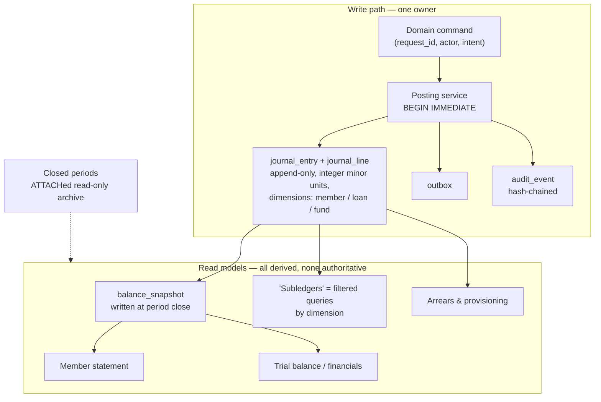

# Production architecture review — a member-finance ledger at 10⁷ rows

Reviewed as a production financial system, not as the current codebase. Where a
current behaviour is named it is as *evidence of a design decision*, not as a
code-level defect — the recommendations are implementation-independent.

Target: **tens of millions of ledger rows**, multi-user, regulated
(SASRA-supervised SACCO), money that must reconcile to the cent and survive an
external audit.

---

## 0. Verdict

The domain model is sound — segregated principal/interest, a real double-entry
general ledger, subledger-to-GL projection, SASRA provisioning bands. That is a
better accounting foundation than most systems of this size have.

The **storage and consistency architecture is not**, and the failures are not
gradual. Five decisions convert an O(1) user action into O(entire history) work,
or make correctness dependent on nothing going wrong. Each has a hard knee well
below 10⁷ rows:

| # | Decision | Knee |
|---|---|---|
| 1 | Money as binary floating point | Already — any index change can alter a report total |
| 2 | The GL is a *rebuildable projection* of subledgers | ~100k subledger rows |
| 3 | Running balances **stored** on every row | ~5k rows per member |
| 4 | Financial history is mutable (UPDATE/DELETE) | Already — an audit finding, not a scale limit |
| 5 | SQLite file on a shared network path, many writers | Already — 2 concurrent users |

None of the five is fixable by tuning. Each needs a different data model. The
rest of this document works through the eleven requested dimensions, then gives
a target architecture and a sequencing plan.

---

## 1. Scale assumptions (making the target concrete)

10⁷ subledger rows is not hypothetical for this domain. At ~4 rows per member
per month (interest accrual, repayment, savings deposit, fund contribution):

```
4 rows/member/month × 12 = 48 rows/member/year
10,000,000 / 48        ≈ 208,000 member-years
                       ≈ a 10,000-member SACCO over 20 years
```

Derived volumes, assuming the current 1 journal entry per subledger row and 2.2
lines per entry:

| Object | Rows | Packed size |
|---|---|---|
| Subledger rows | 10 M | ~2.0 GB (current 20-column layout) |
| Journal entries | 10 M | ~0.6 GB |
| Journal lines | 22 M | ~1.8 GB |
| Indexes | — | ~2–3 GB |
| **Total** | | **~7–9 GB** |

SQLite's own limit is 281 TB, so size is never the constraint. **Every problem
below is an access-pattern problem, not a capacity problem.** That distinction
matters, because it means "move to Postgres" is not automatically the answer —
see §12.

---

## 2. Scalability

### 2.1 The projection rebuild is the single worst scaling decision

The GL is derived from the subledgers, and because member activity supports
edits and undos, the derivation is refreshed by **deleting the entire projected
slice and re-deriving it from scratch** — then this runs on the read path,
before statements are displayed.

At 10⁷ rows that is, in one transaction: 22 M line deletes, 10 M header deletes,
10 M idempotency `SELECT`s, 10 M header inserts, 22 M line inserts. A multi-gigabyte
rollback journal, hours of wall time, the write lock held throughout, and a
crash at 95 % rolls back all of it.

**This is O(all history) work triggered by "show me a statement."**

**Alternative — the ledger is written once and never re-derived.** Post entries
incrementally and correct by reversal. Track a watermark per stream:

```sql
CREATE TABLE projection_watermark (
    stream          TEXT    PRIMARY KEY,   -- 'loan' | 'savings' | 'christmas' | …
    last_source_id  INTEGER NOT NULL,
    updated_at      INTEGER NOT NULL
) STRICT;
```

Posting becomes "everything with `source_id > watermark`" — bounded by *new*
activity, not by history. An edit does not rewrite the past; it posts a
reversing entry plus a replacement, which is what an auditor expects to see
anyway. §5 argues this is required for correctness independently of scale.

The stronger form of this fix — deleting the subledger/GL duality entirely — is
in §11.

### 2.2 Full-history reads on the interactive path

Loading a member's *entire* ledger into a DataFrame to read one number
(`df["balance"].iloc[-1]`) is O(member history) per call, inside loops that are
themselves O(members). At 2,000 rows per member and 10,000 members, a mass
operation is 20 M row materialisations through pandas.

**Alternative:** never materialise history to answer a scalar question. Point
lookups against a snapshot table (§2.3); statements paginate.

### 2.3 Stored running balances

`balance`, `principal_balance`, `interest_balance` and `gross_balance` are
persisted per row. Two consequences:

* **Backdated insert = rewrite the tail.** Inserting a transaction dated last
  March rewrites every subsequent row for that member.
* **It is a denormalised aggregate with no invariant.** Nothing guarantees
  `row.balance` equals the sum of everything before it; the recalculators exist
  precisely because it drifts, and they disagree with each other about the
  arithmetic.

**Alternative — period snapshots plus computation at read time.**

```sql
CREATE TABLE balance_snapshot (
    scope_type    INTEGER NOT NULL,        -- 1=account 2=member 3=loan 4=fund
    scope_id      INTEGER NOT NULL,
    period_id     INTEGER NOT NULL REFERENCES fiscal_period(period_id),
    closing_minor INTEGER NOT NULL,        -- exact, integer cents
    last_entry_id INTEGER NOT NULL,        -- provenance: what this includes
    PRIMARY KEY (scope_type, scope_id, period_id)
) WITHOUT ROWID, STRICT;
```

Any balance = *nearest closed-period snapshot* + delta since. Work is bounded by
one period regardless of total history. Statements compute the running column
with a window function over the page being displayed:

```sql
SELECT entry_date, amount_minor,
       :opening + SUM(amount_minor) OVER (ORDER BY entry_date, line_id) AS running
FROM journal_line …
```

Snapshots are written once at period close and never updated — so they are also
the audit evidence for what the books said at that date.

### 2.4 Batch operations as one giant transaction

Mass catch-up wraps thousands of loans in a single transaction. At scale this
holds the only write lock for minutes-to-hours, and a failure at the end
discards all of it.

**Alternative — chunked, resumable runs.** A `batch_run` table records intent
and progress; work commits every N members; a crash resumes from the cursor
rather than rolling back.

```sql
CREATE TABLE batch_run (
    run_id       INTEGER PRIMARY KEY,
    kind         TEXT    NOT NULL,          -- 'loan_catchup' | 'savings_catchup' | …
    requested_by INTEGER NOT NULL REFERENCES app_user(user_id),
    target_date  INTEGER NOT NULL,
    status       TEXT    NOT NULL,          -- 'running'|'completed'|'failed'|'reverted'
    cursor_id    INTEGER NOT NULL DEFAULT 0,-- resume point
    items_total  INTEGER, items_done INTEGER,
    started_at   INTEGER NOT NULL, finished_at INTEGER
) STRICT;
```

This also gives the `batch_id` UUID a home (§3.4) and makes "revert that run" an
operation on a named entity rather than on an opaque string.

### 2.5 Reporting scans

The trial balance groups all 22 M journal lines by account, every time it is
drawn. The balance sheet folds "cumulative net surplus" over all history because
no period close exists.

**Alternative:** report from `balance_snapshot` + current-period delta. A
month-end trial balance becomes a 25-row read.

### 2.6 Archival

At 10⁷ rows most data is in permanently closed periods. Closed history is
read-only by definition, so it should be physically separated:

```sql
ATTACH DATABASE 'ledger_archive_2015_2022.db' AS archive;  -- read-only
CREATE VIEW journal_line_all AS
    SELECT * FROM archive.journal_line UNION ALL SELECT * FROM main.journal_line;
```

Live file stays small (fast backups, fast `integrity_check`, warm cache);
archives are immutable and can be checksummed once and left alone. In Postgres
this is declarative partitioning by period.

---

## 3. Normalization

### 3.1 The central denormalization: the same fact stored twice

A repayment exists as a subledger row **and** as a journal entry with lines,
joined by a string convention (`'ledger:1234'`). Two representations of one
economic event, kept in agreement by a rebuild process. That is the root cause
of §2.1, and it means a member statement and the trial balance are computed from
different rows and *can* disagree.

**Correct form: post once, to the journal, with dimensions.** Journal lines
carry `member_id`, `loan_id`, `fund_id`. Every "subledger" becomes a query. See
§11.

### 3.2 Cached aggregates with no invalidation contract

| Cached | Derivable from | Drift symptom |
|---|---|---|
| `loans.balance`, `interest_balance`, `unearned_interest` | replaying loan history | the "heal"/"repair" tooling exists for this |
| `individuals.default_deduction` | `SUM(installment)` over active loans | wrong payroll deduction file |
| row-level running balances | preceding rows | statements that don't foot |

Caching aggregates at this scale is *correct* — but only with a maintenance
contract: maintained by trigger or by a single choke-point writer, verified by a
reconciliation job, and never by "remember to call the recalculator."

### 3.3 Repeated wide values in the widest tables

At 22 M lines, column choices cost gigabytes:

| Current | Cost @22 M | Alternative |
|---|---|---|
| `account_code TEXT` as FK | ~110 MB + slow joins | `account_id INTEGER` surrogate; keep `code` unique on the dimension |
| `event_type TEXT` ('Interest Earned') | ~150 MB @10 M | `entry_type_id INTEGER` → lookup table |
| dates as `TEXT` 'YYYY-MM-DD' | ~110 MB per date column, per index copy | `INTEGER` epoch-days |
| `debit REAL` + `credit REAL` | 16 B/line, and permits invalid states | one signed `amount_minor INTEGER` |

The signed-amount change is not just size: with debit/credit pairs, "balanced"
means `SUM(debit) = SUM(credit)` with a float tolerance. With a signed integer it
means `SUM(amount_minor) = 0` — *exact*, and expressible as a database
constraint (§6.2). "One-sided line" stops being a CHECK you have to remember.

### 3.4 Implicit entities with no table

| Implicit | Evidence | Should be |
|---|---|---|
| A batch run | `batch_id` UUID in 4 tables, read back by 4 revert paths | `batch_run` (§2.4) |
| A user | `created_by` column, always NULL | `app_user` + session (§10) |
| A fiscal period | `fy_start_month` setting; "until a period close exists…" | `fiscal_period` (§5.1) |
| A fund | 3 structurally identical tables + a whitelist constant | `fund` dimension + one `fund_transaction` |
| Loan terms | duration recovered by regex from a note string | `loan.duration_months`, `interest_rate_bp` |

Recovering a loan's duration by parsing prose is the most severe of these: a
core contractual term is stored only in a human-readable string, so a note
edit silently changes the loan's mathematics.

### 3.5 Stringly-typed configuration

A key/value `settings` table with values as text, parsed at 21 call sites, each
carrying its own inline default. That is a schema with no schema. Either typed
columns on a singleton row, or a `setting_definition(key, type, default, scope)`
dimension so the default exists exactly once.

---

## 4. Auditability

A production financial system must answer, for any figure: **who changed it,
when, from where, what did it say before, and can I prove the record wasn't
altered afterwards.** Currently: no actor, no before/after, five event types
logged, and the log is a normal table any client can `DELETE` from.

### 4.1 Attribution

Nothing is attributable — `created_by` is never populated because there is no
user concept. For a multi-user application writing to a shared journal this is
disqualifying under any audit standard. Every mutation must carry
`(actor_id, session_id, client_host, request_id)`.

### 4.2 Tamper evidence

Append-only + hash-chained, so alteration or deletion is detectable:

```sql
CREATE TABLE audit_event (
    audit_id    INTEGER PRIMARY KEY,
    occurred_at INTEGER NOT NULL,
    actor_id    INTEGER NOT NULL REFERENCES app_user(user_id),
    session_id  TEXT    NOT NULL,
    action      TEXT    NOT NULL,      -- domain command, not table name
    entity      TEXT    NOT NULL,
    entity_id   INTEGER NOT NULL,
    before_json TEXT,
    after_json  TEXT,
    prev_hash   TEXT    NOT NULL,
    row_hash    TEXT    NOT NULL       -- H(prev_hash ‖ canonical(this row))
) STRICT;

CREATE TRIGGER audit_event_immutable BEFORE UPDATE ON audit_event
BEGIN SELECT RAISE(ABORT, 'audit_event is append-only'); END;
CREATE TRIGGER audit_event_no_delete BEFORE DELETE ON audit_event
BEGIN SELECT RAISE(ABORT, 'audit_event is append-only'); END;
```

Verifying the chain is O(n) but offline. Periodically publishing the head hash
(to a log file, an email, anywhere outside the database) converts "detectable"
into "detectable even by someone with write access to the file."

### 4.3 Audit the command, not only the row

Row-level triggers capture *effects*. An auditor asks about *intent*: "who ran
the mass deduction for June, against which members, with what target date, and
who reverted it." Log the command, and link the resulting entries to it via
`batch_run.run_id`.

### 4.4 Retention and cascade

Audit rows must outlive the rows they describe. Never `ON DELETE CASCADE` an
audit trail, and never hard-delete a financial entity (§9.3) — a deletion is
itself the most audit-relevant event.

### 4.5 Reconciliation as stored evidence

Auditability includes proving the books were checked. Reconciliation runs
(trial balance = 0, GL control account = subledger sum, snapshot = recomputed
balance) should write dated pass/fail records that are themselves immutable, not
just render a green tick in a UI.

---

## 5. Accounting correctness

### 5.1 No fiscal period model — the most serious gap

There is no `fiscal_period`, no close, no lock. Consequences:

* Anyone can post into a prior year and silently restate closed financials.
* Retained earnings never rolls; the balance sheet folds cumulative surplus in
  as a computed line forever.
* Comparatives are not reproducible: last year's balance sheet is recomputed
  from current data, so it changes whenever history is edited.

```sql
CREATE TABLE fiscal_period (
    period_id  INTEGER PRIMARY KEY,
    starts_on  INTEGER NOT NULL,
    ends_on    INTEGER NOT NULL,
    status     TEXT    NOT NULL CHECK (status IN ('open','closed','locked')),
    closed_at  INTEGER, closed_by INTEGER REFERENCES app_user(user_id),
    CHECK (ends_on >= starts_on)
) STRICT;
```

Posting into a non-open period is refused. A correction to a closed period posts
into the **current open period** carrying the original effective date — dual
dating (`entry_date` = when it hit the books, `effective_date` = the economic
date). Reports then reproduce exactly, because "as at 31 Dec" means "entries
posted on or before the close," not "whatever the table says today."

### 5.2 Money as floating point

Binary floats cannot represent 0.01. Three concrete consequences:

* Every comparison needs an epsilon — the balanced-journal test already carries a
  0.005 tolerance, i.e. the system *cannot state* that debits equal credits, only
  that they are close.
* Floating-point addition is **not associative**, so `SUM()` depends on row
  order, which depends on the query plan. **Adding an index can change a
  reported total.** Recent SQLite mitigates this with compensated summation in
  `SUM()`, but that is version-dependent and does not apply to the sums the
  application performs in Python/pandas.
* `math.ceil` rounding produces a systematic over-collection with no
  corresponding account — the residual just lands wherever the last payment
  falls.

**Alternative: `INTEGER` minor units everywhere.** Exact, associative, and it
makes the balance invariant a real constraint. Rounding becomes an explicit,
posted decision: the final installment is adjusted, or the difference goes to a
named rounding account, and either way it is visible.

This is the change most people defer because "the ledgers must match." The
migration is a replay-and-compare exercise, not a column type change — see §13.

### 5.3 Control accounts are unreconciled by construction

GL `1100 Loans Receivable` should equal the sum of loan subledger balances at
all times. Today they are separately maintained, so the only way to know is to
compute both and compare — and nothing does. Under the unified journal (§11)
this holds *by construction*, which is the strongest argument for it.

### 5.4 Interest recognition

Two policy issues that must be explicit and testable:

* **Accrual is event-driven, not period-driven.** Interest is accrued as a
  ledger row when a due date is processed. If the batch doesn't run, the period
  has no interest income — the books depend on operational timing. Accrual
  should be a period process on outstanding principal, independent of whether a
  payment occurred.
* **Straight-line release of pre-computed interest**, not effective interest.
  Total interest is booked as "unearned" at issue and released in equal monthly
  slices. Under IFRS 9 amortised cost this should be effective-interest (EIR).
  Whichever policy the institution adopts, it must be stated, versioned, and
  covered by a test that reproduces a known schedule.

### 5.5 Missing economic events

No double-entry treatment for loan write-off, member exit/refund, share capital
movements, or dividends. Each is a real event in a SACCO; without them they get
recorded as adjustments in a suspense-like account, which is exactly what
auditors flag.

Also missing: a **suspense account** for unallocated receipts. Money that
arrives without a matching member must land somewhere explicit.

### 5.6 Correction model

Posted entries must be immutable; corrections are reversals. The reversal
mechanism exists but sits alongside `UPDATE`/`DELETE` on subledger rows, which
means the GL can be corrected properly while the subledger is edited in place —
so the two diverge until the next rebuild.

---

## 6. Transaction safety

### 6.1 One writer, one boundary

Requirements:

* Exactly one place opens a write transaction, with `BEGIN IMMEDIATE` (§7.3).
* No method that can be called inside a transaction may `commit()`. Any function
  performing DDL-plus-commit on a read path (table-creation helpers called from
  getters, for example) silently commits its caller's partial work — a
  correctness bug at any scale.
* No DDL inside a data transaction.
* Failure of a post-write side effect must not be swallowed. "The GL post hook
  failed, it'll reconcile on the next sync" is only tenable while a full sync is
  cheap; at 10⁷ rows there is no next sync (§2.1). Use a transactional outbox:

```sql
CREATE TABLE outbox (
    outbox_id  INTEGER PRIMARY KEY,
    kind       TEXT    NOT NULL,
    payload    TEXT    NOT NULL,
    created_at INTEGER NOT NULL,
    attempts   INTEGER NOT NULL DEFAULT 0,
    done_at    INTEGER
) STRICT;
```

Written in the same transaction as the business row; drained by a worker. The
side effect can fail and retry without the write being lost or duplicated.

### 6.2 Enforcing the balance invariant in the database

Application-level assertion is not enough — a second writer, a repair script or
a future code path bypasses it. SQLite supports `DEFERRABLE INITIALLY DEFERRED`
foreign keys, which makes this pattern work:

1. Allocate `entry_id` from a sequence.
2. Insert the lines (FK to the not-yet-existing header is deferred).
3. Insert the header **last**, with a `BEFORE INSERT` trigger that aborts unless
   the staged lines sum to zero.

```sql
CREATE TRIGGER journal_entry_must_balance BEFORE INSERT ON journal_entry
WHEN (SELECT COALESCE(SUM(amount_minor), 0)
        FROM journal_line WHERE entry_id = NEW.entry_id) <> 0
BEGIN SELECT RAISE(ABORT, 'journal entry does not balance'); END;
```

Readers join through the header, so a headerless line set is invisible, and the
deferred FK guarantees it cannot survive `COMMIT`. Exact integer arithmetic is
what makes `<> 0` a valid test — this does not work with floats.

*(Postgres does this more directly with a `DEFERRABLE INITIALLY DEFERRED`
constraint trigger — a genuine reason to prefer it, §12.)*

### 6.3 Idempotency

A double-click, a retried request or a resumed batch must not double-post. Every
command carries a client-generated `request_id` with a `UNIQUE` constraint; the
second attempt collides and returns the original result. The current design uses
a `(source, source_ref)` convention for this, checked with SELECT-then-INSERT —
racy, and unenforced.

### 6.4 Nested savepoint policy

Multi-phase imports using savepoints are the right primitive, but the policy
must be defined per phase (which savepoint does phase 3's failure roll back to?)
and tested by fault injection — not left as an open question in a comment.

---

## 7. Concurrency

### 7.1 SQLite allows exactly one writer

Not a tuning parameter. Under WAL, readers don't block the writer and the writer
doesn't block readers, but two writers serialise. Therefore:

* Long write transactions are an availability outage for every other user.
  Chunking (§2.4) is a concurrency fix as much as a scale fix.
* `busy_timeout` turns contention into latency, not correctness — until it
  expires, at which point a user-facing operation fails mid-way.

### 7.2 No optimistic concurrency

Two clerks opening the same loan and saving produce silent last-write-wins.
Mutable aggregates need a version:

```sql
ALTER TABLE loan ADD COLUMN row_version INTEGER NOT NULL DEFAULT 1;
-- UPDATE loan SET …, row_version = row_version + 1
--  WHERE loan_id = ? AND row_version = ?;   -- 0 rows affected ⇒ conflict
```

### 7.3 Lock upgrade is the classic SQLite deadlock

A transaction that starts with `BEGIN` (deferred), reads, then writes must
upgrade a read lock to a write lock. If another writer got there first, SQLite
returns `SQLITE_BUSY` **immediately without invoking the busy handler** — because
waiting would deadlock. So `busy_timeout` does not protect read-then-write
transactions. Every transaction that will write must start `BEGIN IMMEDIATE`.

### 7.4 Sequence generation in application code

Computing the next loan reference as `max(existing) + 1` in Python is a race
between two clients, and a zero-padded 3-digit format has a hard ceiling. Move
generation into the database (`UPDATE … RETURNING` on a counter row, or derive
the display reference from the surrogate key).

### 7.5 Mutually-exclusive operations

Only one mass run should exist at a time. An advisory lock row with the holder's
session and a heartbeat makes that explicit and recoverable after a crash.

---

## 8. Recovery after crashes

### 8.1 Journal mode and durability

Rollback-journal mode with a multi-gigabyte transaction means a crash triggers a
multi-gigabyte rollback on next open. WAL is better on every axis for a local
file — but WAL requires shared memory (`-shm`), which is why it is unavailable
on network filesystems. That constraint is not a reason to keep rollback mode;
**it is a reason not to put the file on a network share** (§7, §12).

For a financial ledger, `synchronous = FULL` under WAL is the defensible
default: `NORMAL` can lose the most recent transactions on power loss. If the
fsync cost is unacceptable, that is a *documented RPO decision*, not an
oversight.

### 8.2 "Backup on open" is not a backup strategy

Copying the entire database at application start, keeping the last ten:

* At 8 GB, that is a multi-minute synchronous startup and 80 GB of copies.
* Copies live **next to the original** — same disk, same ransomware, same
  accidental `rm -rf`.
* Frequency is coupled to how often someone opens the app, so the RPO is
  unbounded.
* Nothing verifies a copy is restorable.

**Alternative:**

* `VACUUM INTO 'snapshot.db'` for consistent hot snapshots on a schedule
  (doesn't hold a long write lock the way a file copy does).
* Continuous WAL shipping for point-in-time recovery — **Litestream** replicates
  a SQLite WAL to object storage with an RPO of seconds and is the standard
  answer here.
* Offsite, encrypted, retention-tiered (daily 30 / monthly 12 / yearly 7 for a
  regulated lender).
* **Automated restore rehearsal**: restore the newest backup into a scratch
  file, run `integrity_check`, `foreign_key_check` and a trial-balance assertion,
  alert on failure. A backup that has never been restored is a hypothesis.

State RPO/RTO explicitly. For a SACCO, RPO ≤ 5 minutes / RTO ≤ 1 hour is a
reasonable target and is achievable with the above.

### 8.3 Conditional integrity enforcement is a recovery anti-pattern

Enabling `PRAGMA foreign_keys` only when the data is already clean means one
orphaned row disables enforcement connection-wide, allowing the next orphan to
be created silently. Corruption becomes self-perpetuating and the system loses
the ability to tell you it is broken.

Enforcement must be unconditional. Data is repaired *during migration*, once,
with evidence — never by permanently relaxing the invariant.

### 8.4 Scheduled verification

`PRAGMA quick_check` at open is good; add scheduled `integrity_check`,
`foreign_key_check`, and the business-level assertions of §4.5, with alerting.
Corruption detected in six months' worth of backups is not recoverable.

---

## 9. Indexing strategy

### 9.1 Derive indexes from a query catalogue

At 10⁷ rows, index design is a deliberate exercise against the ~10 queries that
matter, not a per-column reflex:

| Query | Access path |
|---|---|
| Member statement, date range | `(member_id, entry_date, line_id)` covering the display columns |
| Loan schedule | `(loan_id, entry_date, line_id)` |
| Trial balance for a period | `(account_id, period_id)` — served from snapshots, not lines |
| Arrears / provisioning scan | partial `(next_due_date) WHERE status = 'Active'` |
| Batch revert | partial `(run_id) WHERE run_id IS NOT NULL` |
| Member search | FTS5, not `LIKE`/`COLLATE NOCASE` scans |

### 9.2 SQLite specifics that matter at this size

* **No `INCLUDE` clause** — covering indexes must carry payload columns in the
  key. Weigh index size against avoided table lookups deliberately.
* **Partial indexes are the highest-leverage tool here.** At maturity most loans
  are `Paid`; an index on active loans only stays small forever while the table
  grows. Same for open suspensions and unposted outbox rows.
* **`WITHOUT ROWID`** for narrow PK-dominated tables (snapshots, junctions):
  removes a whole B-tree.
* **Integer dates** shrink every index copy and compare faster than 10-byte text.
* **Write amplification:** each extra index slows bulk insert roughly 20–40 %. A
  10 M-row backfill should load into a staging table, then build indexes once.
* **Statistics:** SQLite's planner without `sqlite_stat1` will choose badly at
  this scale. Run `ANALYZE` after bulk changes and `PRAGMA optimize` on close.
* **Beware indexing low-cardinality columns alone** (`status`, `event_type`) —
  useful only as a leading column of a composite or as a partial-index predicate.

### 9.3 Soft delete changes every index

If financial rows are archived rather than deleted (§10.4), every hot index
needs `WHERE archived_at IS NULL` to avoid dragging dead rows through live
queries.

---

## 10. SQLite-specific improvements

### 10.1 Connection configuration

```sql
PRAGMA journal_mode   = WAL;          -- local storage only
PRAGMA synchronous    = FULL;         -- financial durability; NORMAL = an RPO decision
PRAGMA foreign_keys   = ON;           -- unconditionally (§8.3)
PRAGMA busy_timeout   = 30000;        -- with BEGIN IMMEDIATE (§7.3)
PRAGMA cache_size     = -262144;      -- 256 MB page cache
PRAGMA mmap_size      = 1073741824;   -- 1 GB, local files only
PRAGMA temp_store     = MEMORY;
PRAGMA journal_size_limit = 67108864; -- cap WAL growth after checkpoint
PRAGMA wal_autocheckpoint = 2000;
PRAGMA optimize;                      -- on close
```

Plus `PRAGMA page_size = 8192` **before** first write (wider rows, fewer
overflow pages), and `application_id` / `user_version` so the file self-describes
its schema version.

### 10.2 Features worth adopting (all available on 3.47)

* **`STRICT` tables** (3.37+) — real type enforcement; without it `amount_minor`
  will eventually contain the string `'1200'`.
* **`RETURNING`** (3.35+) — removes the `lastrowid`-after-`executemany` race that
  otherwise requires snapshotting `MAX(id)`.
* **`UPSERT`** for snapshot maintenance.
* **Deferred foreign keys** — enables the balanced-entry trigger of §6.2.
* **Generated columns** for derived display values, so they cannot drift.
* **`VACUUM INTO`** for hot snapshots (§8.2).
* **`ATTACH`-based archival** (§2.6).
* **FTS5** for member search.

### 10.3 SQLite's hard limits — decide with eyes open

| Limit | Consequence |
|---|---|
| One writer | No concurrent posting; batches must chunk |
| No network filesystems | Advisory locking over SMB/NFS is unreliable; a lock failure corrupts rather than errors |
| No built-in replication or PITR | Requires Litestream or equivalent |
| No users, roles, or row-level security | Anyone with file access has full write |
| No deferrable constraint *triggers* | Cross-row invariants need the §6.2 workaround |
| No server-side enforcement | Every client is trusted |

### 10.4 The network-share decision

Hosting a SQLite file on a shared drive so several clerks can open it is the
highest-risk decision in the whole design. The correct fix preserves SQLite:
**one process owns the file**, clients talk to it (local socket, or a small
HTTP/gRPC service on the LAN). That single change delivers WAL, true
serialisation, enforced identity, connection pooling, server-side authorisation
and a place to put the outbox worker — without a database migration.

---

## 11. Target architecture



Four properties this buys, each of which fixes a whole class of problem above:

1. **One source of truth.** A member statement and the trial balance read the
   same rows, so they cannot disagree. Control-account reconciliation is true by
   construction (§5.3), and no projection can drift or need rebuilding (§2.1).
2. **Append-only.** Corrections are reversals, so history is evidence rather than
   state. Audit, undo and "what did the books say in March" become the same
   mechanism (§4, §5.6).
3. **Bounded work.** Snapshots convert every balance question from O(history) to
   O(period) (§2.3, §2.5).
4. **Exact arithmetic.** Integer minor units make the fundamental invariant
   (`SUM = 0`) a database constraint rather than a tolerance (§5.2, §6.2).

Business attributes that are not accounting facts — notes, installment in force,
manual-override flags — hang off the entry header or a `transaction_detail`
table. They do not justify a parallel subledger.

---

## 12. Does this have to leave SQLite?

**Not because of row count.** A properly indexed SQLite database serves 10⁷–10⁸
rows with single-digit-millisecond point queries. The decision is driven by the
*operational* profile, not the data volume:

Move to PostgreSQL when any of these is true:

* More than ~2 sustained concurrent writers, or write bursts that can't be
  chunked below the latency users tolerate.
* The file must live on shared storage and a single-writer service (§10.4) is
  not politically or operationally achievable.
* Regulatory PITR / retention requirements that Litestream doesn't satisfy.
* Row-level security or real role separation is required.
* Reporting load must run concurrently with posting (Postgres: read replica).

What Postgres adds that is specifically valuable here: `NUMERIC` exact decimals,
`DEFERRABLE INITIALLY DEFERRED` constraint triggers (native balanced-entry
enforcement), declarative partitioning by period, MVCC multi-writer, logical
replication, PITR, and row-level security.

Being honest about the counterfactual: with the five headline decisions fixed
and a single-writer service, **SQLite comfortably runs a 10,000-member SACCO for
20 years.** Migrating the database engine while keeping floats, a rebuildable
projection and mutable history would fix nothing.

---

## 13. Sequencing

Ordered by (risk removed ÷ effort), and each step ships independently:

| # | Change | Why first |
|---|---|---|
| 1 | Unconditional FK enforcement + `ON DELETE CASCADE`; stop hard-deleting financial rows | Stops new corruption today; prerequisite for everything |
| 2 | Single-writer service owning the file; WAL; `BEGIN IMMEDIATE` | Removes the corruption risk and the concurrency ceiling with no data migration |
| 3 | Identity + hash-chained audit; attribute every write | Audit gap is unbounded liability and grows with every day of unattributed history |
| 4 | Real backups: `VACUUM INTO` + Litestream + automated restore rehearsal | Cheap, and the current strategy has no RPO |
| 5 | `fiscal_period` + close + posting guard | Blocks silent restatement; prerequisite for snapshots |
| 6 | `balance_snapshot`; stop storing per-row running balances | Removes the per-member rewrite and the O(history) reports |
| 7 | Incremental GL posting + watermark; delete the rebuild path | Removes the O(all history) read-path operation |
| 8 | **Integer minor units** | Highest value, highest care: needs a replay-and-compare harness proving every historical balance reproduces to the cent |
| 9 | Collapse subledger/GL into one dimensioned journal | The end state; safe only once 5–8 are done |
| 10 | Archival of closed periods; partitioning | Only once volume demands it |

Steps 1–4 are operational hardening and can land in weeks. Steps 5–7 are
schema-and-service work. Step 8 is a project with a formal verification plan —
per the existing engineering note that rounding must reproduce existing ledgers
exactly, the acceptance criterion is that every member's closing balance at
every historical month-end is unchanged. Step 9 is the payoff.

---

## 14. Summary of design decisions that will not survive growth

| Decision | Becomes | Replace with |
|---|---|---|
| Money as `REAL` | Reports that vary with the query plan; no exact balance test | `INTEGER` minor units |
| GL as a rebuildable projection | O(all history) work on a read path | Append-only journal + watermark |
| Running balances stored per row | Tail rewrites; aggregates that drift | Period snapshots + window functions |
| Subledger *and* GL storing the same event | Two truths that can disagree | One dimensioned journal |
| Mutable history (`UPDATE`/`DELETE`) | Unauditable; evidence destroyed | Immutable + reversals; soft archive |
| No fiscal periods | Silent restatement of closed years | `fiscal_period` + close + posting guard |
| No user identity | Nothing is attributable | `app_user` + session + chained audit |
| Conditional FK enforcement | Self-perpetuating corruption | Always on; repair once at migration |
| Backup by full copy on open | Multi-minute startup, unbounded RPO, no offsite | `VACUUM INTO` + WAL shipping + restore tests |
| One transaction per mass run | Minutes-long global write lock; all-or-nothing | Chunked, resumable `batch_run` |
| SQLite file on a network share | Lock failures corrupt silently | Single-writer service, or Postgres |
| Sequences generated in Python | Duplicate references under concurrency | DB-side generation |
| No optimistic concurrency | Silent last-write-wins | `row_version` check |
| Loan terms parsed from a note string | A prose edit changes loan mathematics | First-class `duration_months`, `interest_rate_bp` |
| Text enums / text dates in the widest tables | Gigabytes of index and scan overhead | Integer codes and epoch-day integers |
| Key/value settings with defaults at call sites | Divergent behaviour per caller | Typed configuration with one default |
