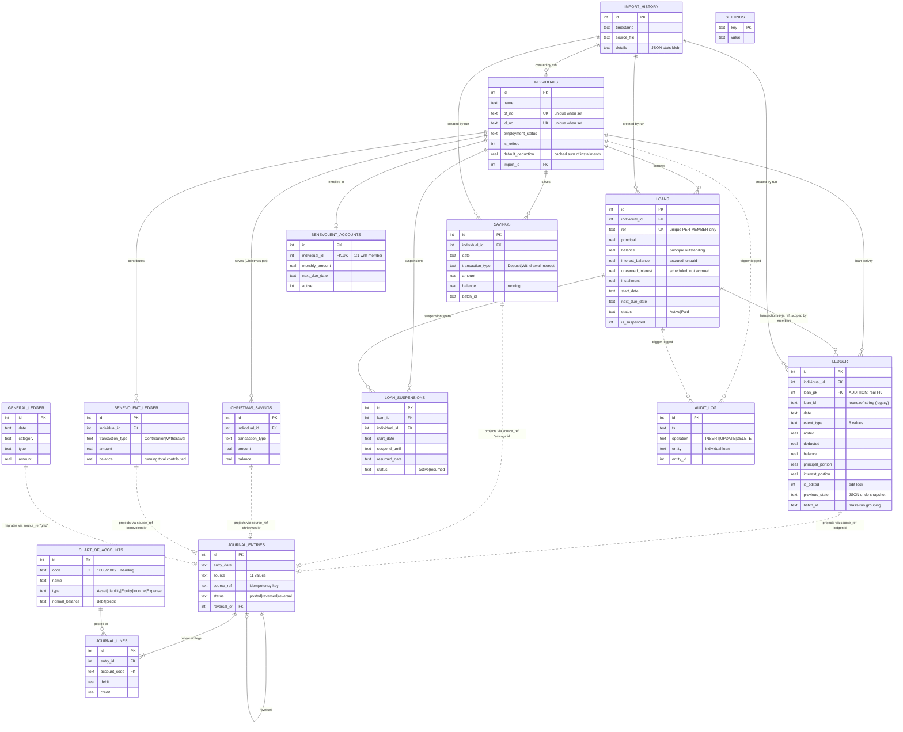
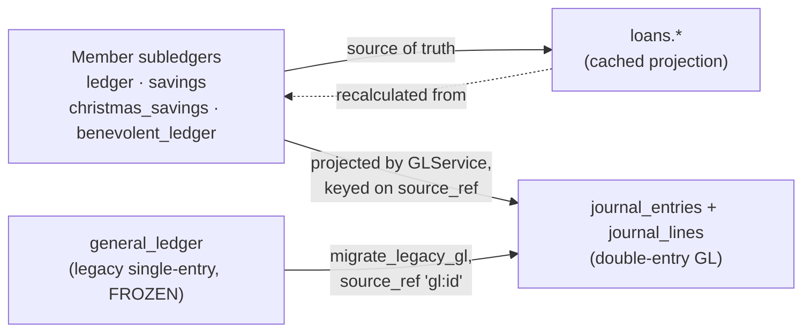

# LoanMaster — reverse-engineered data model

Derived from application behaviour, not from copying DDL: every table below was
confirmed by tracing how the code **creates, updates, queries and deletes** it,
then cross-checked against the live production journal (`loan_master.db`:
119 members, 113 loans, 2,192 ledger rows, 5,333 journal entries, 11,699
journal lines).

Companion files:

| File | Contents |
|---|---|
| [`schema.sql`](../../schema.sql) | Production-ready DDL for a fresh journal |
| [`seed.sql`](../../seed.sql) | Chart of accounts + default settings |
| [`migrations/001_initial_schema.sql`](../../migrations/001_initial_schema.sql) | In-place upgrade of an existing journal |
| [`sql-inventory.md`](sql-inventory.md) | All 436 SQL statements, by table |
| [`inconsistent-sql.md`](inconsistent-sql.md) | Duplicate / divergent queries to consolidate |
| [`repository-layer.md`](repository-layer.md) | Proposed `DatabaseService` / repository design |
| [`architecture-review.md`](architecture-review.md) | Production review at 10⁷ ledger rows: what breaks, and the target architecture |

---

## 1. High-level ER diagram



### How the three "ledgers" relate

This is the single most important thing to understand about the model, and it
is not obvious from the DDL:



* `ledger` is the **source of truth**. `loans.balance`, `loans.interest_balance`
  and `individuals.default_deduction` are caches that `BalanceRecalculator`
  re-derives by replaying it.
* The double-entry GL is a **projection**, not an independent book:
  `GLService.rebuild_auto_journals` deletes and re-derives every entry whose
  `source` is in the auto set, keeping only `manual`, `migration`, `provision`
  and `reversal` entries. `source_ref` (`'ledger:1234'`) is what makes that
  idempotent.
* `general_ledger` is frozen legacy — nothing writes to it; it exists only as
  input to the migration.

---

## 2. Complete schema

Types are SQLite storage classes. "Live" = exists in production today;
"ADDITION" = recommended, included in `schema.sql` and the migration.

### 2.1 `individuals` — the SACCO member

Root of every ownership chain. Created by the member dialog, the external-journal
import, and the Excel roster import.

| Column | Type | Constraints | Notes |
|---|---|---|---|
| `id` | INTEGER | PK AUTOINCREMENT | |
| `name` | TEXT | NOT NULL, `length(trim(name)) > 0` | Duplicate detection is case-insensitive (`individual_name_exists`) but *not* unique — deliberate: real SACCOs have namesakes |
| `phone` | TEXT | DEFAULT `''` | See §4.5 — should be NOT NULL once the write path coalesces |
| `email` | TEXT | DEFAULT `''` | idem |
| `default_deduction` | REAL | NOT NULL DEFAULT 0, `>= 0` | **Denormalised cache** of `SUM(installment)` over active loans |
| `employment_status` | TEXT | NOT NULL DEFAULT `'Active'` | Open domain; anything ≠ `'Active'` retires the member |
| `is_retired` | INTEGER | NOT NULL DEFAULT 0, IN (0,1) | Derived from `employment_status` |
| `retired_date` | TEXT | date-shaped or NULL | Paired with `is_retired` by CHECK |
| `pf_no` | TEXT | NOT NULL DEFAULT `''`, **unique when non-blank** | Provident-fund / payroll number |
| `id_no` | TEXT | NOT NULL DEFAULT `''`, **unique when non-blank** | National ID |
| `import_id` | INTEGER | FK → `import_history(id)` ON DELETE SET NULL | Set only on INSERT, so undo never deletes merged members |
| `created_at` | TEXT | NOT NULL DEFAULT `datetime('now')` | |
| `updated_at` | TEXT | | Maintained by `trg_individuals_updated` |

**Keys** PK `id`; partial unique indexes on `pf_no` and `id_no`.
**Indexes** `idx_individuals_pf_no`, `idx_individuals_id_no` (live);
`idx_individuals_name_nocase`, `idx_individuals_import` (ADDITION).
**Children** `loans`, `ledger`, `savings`, `christmas_savings`,
`benevolent_ledger`, `benevolent_accounts` (1:1), `loan_suspensions`.

### 2.2 `loans` — a loan account

Segregated principal/interest model. `ref` (`L-001`) is generated as
`max(existing ref)+1` **per member**, so it is unique per member only — every
query must scope by `individual_id` too.

| Column | Type | Constraints | Notes |
|---|---|---|---|
| `id` | INTEGER | PK AUTOINCREMENT | |
| `individual_id` | INTEGER | NOT NULL, FK → `individuals(id)` ON DELETE CASCADE | |
| `ref` | TEXT | NOT NULL, **UNIQUE (individual_id, ref)** (ADDITION) | |
| `principal` | REAL | NOT NULL DEFAULT 0, `>= 0` | Original amount lent |
| `total_amount` | REAL | NOT NULL DEFAULT 0 | principal + total interest |
| `balance` | REAL | NOT NULL DEFAULT 0 | **Principal outstanding only** (2 live rows are slightly negative from legacy rounding — hence no `>= 0` CHECK) |
| `installment` | REAL | NOT NULL DEFAULT 0, `>= 0` | `ceil(total / duration)` |
| `monthly_interest` | REAL | NOT NULL DEFAULT 0 | `ceil(interest / duration)` |
| `unearned_interest` | REAL | NOT NULL DEFAULT 0 | Scheduled, not yet accrued |
| `interest_balance` | REAL | NOT NULL DEFAULT 0 | Accrued, not yet repaid |
| `start_date` | TEXT | NOT NULL, date-shaped | |
| `next_due_date` | TEXT | date-shaped, `''` or NULL | Cleared to `''` on buyoff |
| `status` | TEXT | NOT NULL DEFAULT `'Active'`, IN (`'Active'`,`'Paid'`) | Only these two values exist in 113 live rows |
| `is_suspended` | INTEGER | NOT NULL DEFAULT 0, IN (0,1) | Current state only |
| `suspend_until` | TEXT | date-shaped or NULL | NULL = indefinite |
| `import_id` | INTEGER | FK → `import_history(id)` | |
| `created_at`, `updated_at` | TEXT | | Trigger-maintained |

**Indexes** `idx_loans_individual`, `idx_loans_status_due`, `idx_loans_import`
(all ADDITIONS — production has **no index on this table at all** today).

### 2.3 `loan_suspensions` — suspension history

`loans.is_suspended` / `suspend_until` hold only the *current* state. This table
records every span, including backdated and already-closed ones, so statements
can annotate "no deductions for months x, y, z" after a loan resumes, and so
`catch_up_loan` skips suspended due dates.

| Column | Type | Constraints |
|---|---|---|
| `id` | INTEGER | PK |
| `loan_id` | INTEGER | FK → `loans(id)` ON DELETE CASCADE (nullable: the import path can insert a span whose loan didn't resolve) |
| `individual_id` | INTEGER | NOT NULL, FK → `individuals(id)` ON DELETE CASCADE |
| `loan_ref` | TEXT | Denormalised copy of `loans.ref` |
| `start_date` | TEXT | NOT NULL |
| `suspend_until` | TEXT | NULL = indefinite |
| `resumed_date` | TEXT | NULL = still open |
| `status` | TEXT | NOT NULL, IN (`'active'`,`'resumed'`), paired with `resumed_date` by CHECK |
| `created_at` | TEXT | NOT NULL DEFAULT `datetime('now')` |

**Indexes** `idx_suspensions_individual`, `idx_suspensions_loan`, and a **partial
unique index** on `(loan_id) WHERE resumed_date IS NULL AND status='active'` —
`suspend_loan()` assumes at most one open span per loan and finds it with
`ORDER BY id DESC LIMIT 1`; the index makes that assumption structural.

### 2.4 `ledger` — the loan subledger

Append-mostly per-member transaction history: the replay source everything else
is derived from.

| Column | Type | Constraints | Notes |
|---|---|---|---|
| `id` | INTEGER | PK AUTOINCREMENT | Referenced by GL `source_ref` as `'ledger:<id>'` — **never renumber** |
| `individual_id` | INTEGER | NOT NULL, FK → `individuals(id)` ON DELETE CASCADE | |
| `date` | TEXT | NOT NULL, date-shaped | |
| `event_type` | TEXT | NOT NULL, IN (`Loan Issued`, `Loan Top-Up`, `Interest Earned`, `Repayment`, `Loan Buyoff`, `Loan Restructure`) | First five occur in live data; `Loan Restructure` is written by `LoanService.restructure_loan` |
| `loan_id` | TEXT | NOT NULL | **Misnamed: holds `loans.ref`, not an id** |
| `loan_pk` | INTEGER | FK → `loans(id)` ON DELETE CASCADE | **ADDITION** — the real relationship |
| `added` | REAL | NOT NULL DEFAULT 0, `>= 0` | Debt increase |
| `deducted` | REAL | NOT NULL DEFAULT 0, `>= 0` | Debt decrease; CHECK `added = 0 OR deducted = 0` |
| `balance` | REAL | NOT NULL DEFAULT 0 | Running total debt |
| `notes` | TEXT | NOT NULL DEFAULT `''` | The `Loan Issued` note is **parsed** by the heal tool (`Principal: … Total Interest: … Duration: …`) — see §4.7 |
| `installment_amount` | REAL | NOT NULL DEFAULT 0 | Schedule in force at this row |
| `interest_amount` | REAL | NOT NULL DEFAULT 0 | Accrual amount, or the stored rate on an edited repayment |
| `principal_balance`, `interest_balance`, `gross_balance` | REAL | NOT NULL DEFAULT 0 | Running components |
| `principal_portion`, `interest_portion` | REAL | NOT NULL DEFAULT 0 | Repayment split; the GL posts from these |
| `is_edited` | INTEGER | NOT NULL DEFAULT 0, IN (0,1) | **Edit lock**: 1 means a human set the amount and the recalculator must not overwrite it. Legacy rows stored the payment *amount* here (e.g. 5857); `create_tables` normalises those to 1 |
| `previous_state` | TEXT | | JSON snapshot of loan terms before this row (undo) |
| `batch_id` | TEXT | | UUID grouping one mass catch-up run |
| `import_id` | INTEGER | FK → `import_history(id)` | |

**Indexes** (all ADDITIONS — production has none):
`(individual_id, date, id)`, `(individual_id, loan_id, date, id)`, `(loan_pk)`,
partial on `batch_id` and `import_id`, and `(date, id)` for the GL backfill scan.

### 2.5 `savings`, `christmas_savings`, `benevolent_ledger` — member fund subledgers

Three structurally identical tables. `DatabaseManager` already drives the latter
two through one generic `fund_*` API over a whitelisted table name — strong
evidence they are one entity with a discriminator (see §4.2).

| Column | Type | savings | christmas_savings | benevolent_ledger |
|---|---|---|---|---|
| `id` | INTEGER | PK | PK | PK |
| `individual_id` | INTEGER | FK CASCADE | FK CASCADE | FK CASCADE |
| `date` | TEXT | NOT NULL | NOT NULL | NOT NULL |
| `transaction_type` | TEXT | `Deposit`/`Withdrawal`/`Interest` | same | `Contribution`/`Withdrawal` (+`Deposit`/`Interest` accepted) |
| `amount` | REAL | NOT NULL `>= 0` | same | same |
| `balance` | REAL | running balance | running balance | running **total contributed** |
| `notes`, `batch_id`, `created_at` | TEXT | ✓ | ✓ | ✓ |
| `import_id` | INTEGER | ✓ | — | — |

Business rules that live in services, not the schema: Christmas withdrawals are
refused outside `christmas_unlock_month`; the benevolent fund is perpetual and
never "paid off".

### 2.6 `benevolent_accounts` — benevolent enrolment (1:1)

Exactly zero or one row per member (`individual_id UNIQUE`), holding the
recurring-deduction schedule: `monthly_amount`, `start_date`, `next_due_date`,
`active`. Christmas has no equivalent — its increment is inferred from deposit
history plus the `default_christmas_increment` setting. That asymmetry is real,
not an oversight.

### 2.7 `chart_of_accounts`, `journal_entries`, `journal_lines` — double-entry GL

| Table | Purpose | Key constraints |
|---|---|---|
| `chart_of_accounts` | Account master, seeded from `src/config.py` | `code` UNIQUE NOT NULL; `type` ∈ 5 values; `normal_balance` ∈ (`debit`,`credit`) |
| `journal_entries` | Balanced transaction header | `source` ∈ 11 values; `status` ∈ (`posted`,`reversed`,`reversal`); `reversal_of` self-FK; **`(source, source_ref)` UNIQUE when `source_ref` is set** (ADDITION) |
| `journal_lines` | Debit/credit detail | FK → entries CASCADE, FK → accounts RESTRICT; `debit,credit >= 0`; CHECK exactly one side non-zero |

`source` values observed or written: `manual`, `loan_disbursement`, `repayment`,
`interest`, `savings`, `christmas`, `benevolent`, `provision`, `reversal`,
`migration`, `backfill`.

The invariant `SUM(debit) = SUM(credit)` per entry is enforced in
`GLService.post_journal` (tolerance 0.005) — all 5,333 live entries satisfy it.
It cannot be expressed as a row-level CHECK, so `schema.sql` ships
`v_unbalanced_entries` as a health probe instead, plus immutability triggers so
posted entries can only be corrected by reversal.

### 2.8 `general_ledger` — legacy single-entry treasury (FROZEN)

No code writes to it. Retained read-only as input to
`GLService.migrate_legacy_gl`, which converts each row into a balanced journal
(`source_ref = 'gl:<id>'`). One row survives in production. `type` ∈ (`Income`,
`Expense`, `Asset`, `Liability/Equity`) — inferred from the migration's branch
logic, not from data.

### 2.9 `settings` — per-journal configuration

`key TEXT PRIMARY KEY, value TEXT`. All ten keys the code reads are enumerated
in `seed.sql`. Values are stringly typed: booleans as `'true'`/`'false'`,
numbers as decimal strings, colours as `'#RRGGBB'`.

### 2.10 `import_history` — external-journal import runs

One row per run; `details` holds a JSON stats blob (`json.dumps(stats)`).
Children carry `import_id` so `undo_import` can delete a whole run in
dependency order. Note it is **only** written by the SQLite-journal import —
the Excel importer records nothing (§4.8).

### 2.11 `audit_log` — trigger-maintained CRUD trail

Deliberately narrow: all `individuals` CRUD, `loans` create/delete only. Loan
UPDATEs and ledger rows churn on every recalculation and would flood the log;
the ledger is already its own dated history.

---

## 3. Relationship summary

| Parent | Child | Cardinality | Enforced today? | Recommended |
|---|---|---|---|---|
| individuals | loans | 1:N | FK declared, **not enforced** when legacy orphans exist | FK + ON DELETE CASCADE |
| individuals | ledger | 1:N | idem | FK + CASCADE |
| individuals | savings / christmas_savings / benevolent_ledger | 1:N | idem | FK + CASCADE |
| individuals | benevolent_accounts | **1:0..1** | UNIQUE + FK | FK + CASCADE |
| individuals | loan_suspensions | 1:N | FK declared | FK + CASCADE |
| loans | ledger | 1:N | **not a foreign key** — joined on `(individual_id, ref)` | add `ledger.loan_pk` FK |
| loans | loan_suspensions | 1:N | FK declared | FK + CASCADE |
| import_history | individuals / loans / ledger / savings | 1:N | **no FK at all** | FK ON DELETE SET NULL |
| journal_entries | journal_lines | 1:N (≥2 in practice) | FK declared | FK + CASCADE |
| chart_of_accounts | journal_lines | 1:N | FK declared on `code` | FK + ON UPDATE CASCADE / ON DELETE RESTRICT |
| journal_entries | journal_entries | 1:0..1 (reversal) | **no FK** | self-FK RESTRICT |
| ledger / savings / funds | journal_entries | 1:0..1 by `source_ref` | string convention only | keep as a convention; add the UNIQUE index |

**No many-to-many relationships exist**, so no junction tables are needed. The
one candidate — a mass catch-up run touching many members — is currently modelled
by a bare `batch_id` UUID string; see §4.6 for the `batches` table that would
turn it into a proper entity.

**Foreign keys implied by code but not enforced by SQL** — recommend adding all
of these (the migration does):

1. `ledger.loan_id` → `loans.ref` scoped by member. Every `delete_loan`,
   `rebuild_loan_schedule` and heal path manually deletes the matching ledger
   rows; that's a cascade written by hand.
2. `individuals.import_id`, `loans.import_id`, `ledger.import_id`,
   `savings.import_id` → `import_history.id`. `undo_import` deletes by these.
3. `journal_entries.reversal_of` → `journal_entries.id`.
4. `loan_suspensions.loan_id` is declared but `_import_aux_tables` can insert
   NULL when a ref doesn't resolve — kept nullable deliberately.

---

## 4. Missing schema improvements

### 4.1 Missing indexes (the highest-value change)

Production has **six** indexes, all on `audit_log`, `individuals(pf_no/id_no)`
and the journal tables. There is **not one index on `ledger`, `loans`,
`savings`, `christmas_savings`, `benevolent_ledger` or `loan_suspensions`** —
every read on those is a full table scan.

| Index | Serves |
|---|---|
| `ledger(individual_id, date, id)` | `get_ledger` — called on essentially every screen refresh, and once per member inside recalculation loops |
| `ledger(individual_id, loan_id, date, id)` | the ~15 loan-scoped `COUNT/MIN/MAX/DELETE` queries in `loan_service`, `engine`, `transaction_manager` |
| `ledger(date, id)` | `backfill_from_subledgers` full-table ordered scan (runs on every GL sync) |
| `ledger(batch_id)`, `savings(batch_id)`, fund `(batch_id)` | every mass-run revert |
| `ledger(import_id)` etc. | `undo_import` |
| `loans(individual_id)` | `get_loans`, `get_active_loans`, `get_loan_by_ref` |
| `loans(status, next_due_date)` | `get_all_active_loans`, `get_overdue_count`, provisioning |
| `savings(individual_id, date, id)` and fund equivalents | balance lookups (`ORDER BY date DESC, id DESC LIMIT 1`) and recalculation |
| `individuals(name COLLATE NOCASE)` | duplicate detection on every import row |
| `journal_entries(entry_date, id)` | trial balance / statements date filters |

At 2,192 ledger rows the scans are invisible; the recalculation paths are
O(members × transactions), so this degrades super-linearly as the journal grows.

### 4.2 Duplicate data / normalisation opportunities

1. **Three identical fund tables.** `savings`, `christmas_savings` and
   `benevolent_ledger` have the same shape, and `DatabaseManager._FUND_TABLES`
   already whitelists two of them for one generic API. The normalised form:

   ```sql
   CREATE TABLE funds (            -- reference data: 'savings' | 'christmas' | 'benevolent'
       code TEXT PRIMARY KEY, name TEXT NOT NULL, allows_withdrawal INTEGER NOT NULL DEFAULT 1
   );
   CREATE TABLE fund_transactions (
       id INTEGER PRIMARY KEY AUTOINCREMENT,
       fund_code TEXT NOT NULL REFERENCES funds(code),
       individual_id INTEGER NOT NULL REFERENCES individuals(id) ON DELETE CASCADE,
       date TEXT NOT NULL, transaction_type TEXT NOT NULL,
       amount REAL NOT NULL CHECK (amount >= 0), balance REAL NOT NULL DEFAULT 0,
       notes TEXT NOT NULL DEFAULT '', batch_id TEXT, import_id INTEGER, created_at TEXT
   );
   CREATE INDEX idx_fund_txn ON fund_transactions(fund_code, individual_id, date, id);
   ```

   This collapses three near-duplicate code paths and makes adding a fourth pot
   a data change instead of a schema change. **Deliberately not in
   `schema.sql`**: it invalidates every `source_ref` (`'savings:12'`,
   `'christmas:12'` would collide), so it needs its own migration that rewrites
   the GL projection. Treat it as migration 002.

2. **`loan_suspensions.loan_ref` duplicates `loans.ref`.** Kept because the
   import path writes spans before the loan resolves; once `loan_id` is a
   reliable FK it should be dropped and read through the join.

3. **`individuals.default_deduction`** duplicates `SUM(loans.installment)`.
   Genuinely useful as a cache (payroll export reads it hot), but nothing
   guarantees freshness except discipline — every mutation path must remember to
   call `_recalculate_default_deduction`. Either make it a generated read model
   (`v_member_position` does this) or maintain it with a trigger.

4. **`ledger.previous_state` (JSON) duplicates loan columns.** A denormalised
   undo snapshot. Acceptable for undo, but it means loan history exists in two
   incompatible formats. If undo depth ever needs to survive a restart, promote
   it to a `loan_state_history` table.

5. **`loans.balance` / `interest_balance` / `unearned_interest`** are all
   derivable by replaying `ledger`. That is exactly what `BalanceRecalculator`
   does. They are a cache, and the "loan repair"/"heal" tools exist precisely
   because the cache drifts.

### 4.3 Missing constraints

| Constraint | Why it matters |
|---|---|
| `UNIQUE (loans.individual_id, ref)` | The per-member ref rule is defended by hand in the import path (`-Import`, `-Import-1` suffixing). Nothing stops two code paths racing to `L-004` |
| `UNIQUE (journal_entries.source, source_ref) WHERE source_ref IS NOT NULL` | `post_journal`'s idempotency is a SELECT-then-INSERT — racy, and the live-write hooks fire from multiple paths. This is the constraint that guarantees a subledger row can never post twice |
| CHECK on every enum (`event_type`, `transaction_type`, `status`, `type`, `normal_balance`, `operation`, `entity`) | A typo in a literal currently persists silently and then silently fails to match any `IN (...)` filter downstream |
| `CHECK (is_edited IN (0,1))` | The `is_edited`-holds-an-amount corruption reached production and needed a repair pass. The CHECK makes it unrepresentable |
| `CHECK (debit >= 0 AND credit >= 0)` and one-sidedness on `journal_lines` | Validated in Python only |
| `CHECK (added = 0 OR deducted = 0)` on `ledger` | Holds for all 2,192 live rows; a row with both would silently corrupt every running balance |
| FKs with `ON DELETE CASCADE` | See §4.4 |

### 4.4 The orphan bug this fixes

`delete_individual` deletes from `ledger` and `individuals` — **and nothing
else**. Savings, both funds, the benevolent enrolment and suspension history are
left behind, pointing at a member id that no longer exists. Those orphans then
skew every aggregate that sums a child table directly, and — because
`_configure_connection` only turns on `PRAGMA foreign_keys` when
`foreign_key_check` is clean — a single orphan **disables FK enforcement for the
entire connection**, so the next orphan is created silently too. That is a
self-reinforcing failure mode, and it is why the app needs a Repair tool at all.

Declaring `ON DELETE CASCADE` removes the class of bug: verified in a smoke test
against the migrated journal, deleting a member now clears all seven child
tables with zero leftovers.

### 4.5 Nullable columns that shouldn't be nullable

Every column marked NOT NULL in `schema.sql` was verified to have no NULLs in
production. Two could not be tightened:

* **`individuals.phone` / `email`** — `add_individual` passes the dialog value
  straight through, which is `None` for a blank field. Fix: coalesce to `''` at
  the write path (`phone or ''`, exactly as `pf_no`/`id_no` already do), then
  make them NOT NULL. Left nullable in `schema.sql` so the migration is drop-in.
* **`loans.next_due_date`** — genuinely absent after a buyoff, but written as
  `''` rather than NULL. Empty-string-as-null is used inconsistently across the
  schema (`suspend_until`, `retired_date`, `next_due_date`); pick NULL and
  normalise.

### 4.6 Columns that should be split, and better naming

| Current | Problem | Recommended |
|---|---|---|
| `ledger.loan_id` (TEXT) | Named like a foreign key, holds a *reference string*, and is only meaningful with `individual_id`. This naming is the direct cause of the "loan refs are unique per member only" footgun documented in `CLAUDE.md` | Rename to `loan_ref`; add `loan_pk` INTEGER FK (done in `schema.sql`) |
| `ledger.is_edited` | An edit *lock* whose historical values were payment amounts | Rename to `is_amount_locked`; keep 0/1 |
| `ledger.balance` vs `principal_balance` / `interest_balance` / `gross_balance` | Four running balances with no naming discipline about what each includes | `total_debt_balance`, `principal_balance`, `interest_balance`, `gross_debt_balance` |
| `loans.balance` | Means *principal outstanding*, not total balance — a reader will get this wrong | `principal_outstanding` |
| `loans.total_amount` | Ambiguous: original total, not current | `original_total_repayable` |
| `individuals` (table) | It's a member table in a members' organisation | `members` |
| `ledger` (table) | Collides conceptually with the general ledger | `loan_transactions` |
| `batch_id` (4 tables) | An implicit entity with no home | a `batches(id, kind, started_at, target_date, actor, item_count)` table, FK from each subledger. It would let the UI list past mass runs and revert them by name instead of by opaque UUID |
| `import_history.details` | A JSON blob queried by nothing | Split into typed counter columns, or keep as a blob and stop pretending it's queryable |

### 4.7 Data hiding in text

`engine._loan_heal_plan` recovers a loan's original terms by **regex-parsing
`ledger.notes`**:

```python
mp = re.search(r"Principal:\s*([\d.]+)", note)
mi = re.search(r"Total Interest:\s*([\d.]+)", note)
md = re.search(r"Duration:\s*(\d+)",  note)
```

The loan's duration exists *only* inside a human-readable note string —
`loans` has no `duration_months` column, yet duration is needed to recompute
`installment` and `monthly_interest`. Recommend adding `loans.duration_months
INTEGER` and `loans.interest_rate REAL`, backfilled from the note where
parseable. (Not in `schema.sql`: backfilling is a data-quality exercise that
needs a human to adjudicate unparseable notes, and the heal tool's whole
purpose is to flag those.)

### 4.8 Other findings

* **Columns the code references that do not exist.**
  `UndoManager.DeleteTransactionCommand.undo()` inserts into
  `ledger (…, principal_amount, linked_trans_id)`. Neither column exists in any
  schema version. That code path raises `OperationalError` if ever reached — it
  is dead legacy (the live path is `UndoTransactionCommand`). Delete the class
  rather than adding the columns; there is no evidence the model needs them.
* **No user/authentication table.** `journal_entries.created_by` exists and is
  **always NULL** — no call site populates it. For a multi-user desktop app
  writing to a shared journal, "who posted this" is currently unanswerable.
* **No fiscal period / period-close table.** `get_balance_sheet` says "until a
  period close exists, the cumulative net surplus is folded into equity", and
  `fy_start_month` lives in `settings`. A `fiscal_periods(id, start, end,
  status, closed_at)` table is clearly anticipated but does not exist — **not
  created here**, as the closing logic doesn't exist either.

### 4.9 Security concerns

1. **SQL injection surface is small but real.** All user-facing values are
   parameterised. Four places interpolate identifiers into f-strings:
   `DatabaseManager.fund_*` (whitelisted via `_fund_table`, safe),
   `_tables_with_individual_id` / `find_orphaned_rows` /
   `delete_orphaned_rows` / `_import_aux_tables` (table names read from
   `sqlite_master` — safe in practice, but a table named by an attacker-supplied
   import file would be interpolated). Prefer quoting identifiers explicitly.
2. **Imports read arbitrary attacker-chosen SQLite files.** `validate_source_schema`
   checks only that `individuals(name)` exists. A malicious journal cannot inject
   SQL, but it *can* carry a table whose name is interpolated in
   `_import_aux_tables`. Constrain the copy to a fixed table allowlist.
3. **No row-level or user-level access control** — any user of the desktop app
   has full write access to every member's data, and the audit log records *what*
   changed but never *who*.
4. **PII at rest is unencrypted** — names, phone numbers, emails, national ID and
   payroll numbers in a plain SQLite file, commonly hosted on a network share
   (WAL is deliberately disabled for exactly that reason). SQLCipher or
   OS-level encryption is the mitigation; at minimum, document the exposure.
5. **Backups inherit the exposure.** `_backup_on_open` writes up to ten
   unencrypted copies to `backups/` next to the journal.

---

## 5. Migration plan

The goal is to move from "inline SQL defines the schema by accident" to "the
schema is a versioned artefact" **without data loss and without a big-bang
rewrite**.

### Stage 0 — Freeze the current shape (done)

`schema.sql` is now the canonical definition, and it is byte-for-byte capable of
producing a journal the current application can use. `create_tables()` remains
in place for now; it is idempotent and will simply find everything already
present.

### Stage 1 — Migrate an existing journal

```bash
# 1. Close the app on every workstation. Take a cold backup.
cp loan_master.db loan_master.pre-001.db.bak

# 2. Clear pre-existing data problems (the app's own tools):
#    Dashboard → Repair → Orphaned records   (export the audit workbook first)
#    Dashboard → Repair → Loans              (heals stale loan terms)

# 3. Dry run on a copy — this is the real rehearsal, not a formality.
cp loan_master.db /tmp/rehearsal.db
sqlite3 -bail /tmp/rehearsal.db < migrations/001_initial_schema.sql

# 4. Verify the rehearsal (row counts must match exactly, FK check must be empty)
sqlite3 /tmp/rehearsal.db "PRAGMA foreign_key_check; PRAGMA integrity_check;
                           SELECT COUNT(*) FROM ledger; SELECT COUNT(*) FROM journal_lines;"

# 5. Apply for real, then re-open the app and confirm the dashboard totals and
#    the trial balance are unchanged.
sqlite3 -bail loan_master.db < migrations/001_initial_schema.sql
```

**Why it is safe.** The migration is one transaction with pre-flight guards that
abort *before* any table is touched (they fail a CHECK, which rolls the
transaction back), row ids are copied explicitly so every foreign key and every
`source_ref` like `'ledger:1234'` still resolves, and post-flight guards refuse
to commit unless `foreign_key_check` is empty and `ledger.loan_pk` is fully
backfilled.

**Verified**, not asserted: run against a copy of the production journal, all 15
tables kept identical row counts, `ledger`/`loans`/`journal_lines` contents
compared row-by-row and identical, `foreign_key_check` empty, `integrity_check`
ok, 2,192/2,192 `loan_pk` values backfilled, runtime 0.13 s. A follow-up smoke
test then drove the real application against the migrated journal — create
member, issue loan, catch-up, top-up, buyoff, savings, both funds, suspend and
resume, GL sync (trial balance balanced), delete member — with zero FK
violations and all seven child tables correctly cascaded.

**Rollback** is restoring the `.bak`. The migration takes no incremental
approach that could leave a half-state.

### Stage 2 — Make the code stop defining the schema

1. Move `create_tables()`'s DDL out of `src/database.py` and into
   `schema.sql`, loaded at startup for a new journal:

   ```python
   def _bootstrap(self):
       if not self._table_exists("individuals"):
           self.conn.executescript(_read_resource("schema.sql"))
           self.conn.executescript(_read_resource("seed.sql"))
       self._apply_pending_migrations()
   ```

2. Add a `schema_migrations(version INTEGER PRIMARY KEY, applied_at TEXT)`
   table and a tiny runner that applies `migrations/NNN_*.sql` in order inside a
   transaction. Record `001` as already applied for journals migrated by hand in
   Stage 1.

3. Delete the ~40 `try: ALTER TABLE … except OperationalError: pass` blocks. They
   are a migration system with no version number, no ordering guarantee and no
   failure reporting — every one of them is silently a no-op today.

4. Keep the on-open backup (`_backup_on_open`) and run it *before* the migration
   runner, which is already the current ordering.

### Stage 3 — Introduce the repository layer

See [`repository-layer.md`](repository-layer.md). The sequencing matters: do it
*after* Stage 2, so repositories are written against a schema that is already
authoritative, and *incrementally* — one repository per PR, with
`DatabaseManager` delegating to it, so the 220-test suite stays green throughout.

### Stage 4 — Deferred, higher-risk migrations

Each needs its own migration file and its own rehearsal:

* **002** — unify the three fund tables into `fund_transactions` (§4.2). Must
  rewrite GL `source_ref` values in the same transaction.
* **003** — `loans.duration_months` / `interest_rate`, backfilled from the issue
  note, with a report of unparseable rows for a human to resolve (§4.7).
* **004** — `batches` table; backfill from distinct `batch_id` values (§4.6).
* **005** — money as INTEGER cents. Explicitly out of scope per `CLAUDE.md`: it
  must reproduce existing ledgers exactly, so it needs a full replay-and-compare
  harness, not a column type change.

---

## 6. Confidence report

| Table | Confidence | Basis and assumptions |
|---|---|---|
| `individuals` | **High** | Created, read, updated, deleted and imported across every layer; all columns observed in live data; enum for `employment_status` deliberately left open (only `'Active'` appears in 119 rows, but the code treats any other value as "retired", so a closed CHECK would be wrong) |
| `loans` | **High** | Full lifecycle in `LoanService`; `status` domain confirmed as exactly {Active, Paid} in code and in 113 rows. Assumption: `balance` may be negative (2 live rows), so no non-negative CHECK |
| `ledger` | **High** | 67 statements across 8 files; every column's meaning traced to a writer and a reader. Assumption: `Loan Restructure` belongs in the `event_type` domain — it is written by `restructure_loan` but appears in no live row |
| `savings` | **High** | Full CRUD plus recalculation, three separate implementations of the running balance |
| `christmas_savings` / `benevolent_ledger` | **High** | Created by one shared DDL loop; driven by the generic `fund_*` API; both services read and write them. `benevolent_ledger.transaction_type` domain is widened to include `Deposit`/`Interest` because `fund_add_transaction` is generic and would accept them |
| `benevolent_accounts` | **High** | Explicit `UNIQUE` on `individual_id`; upsert, read and schedule-advance paths all present |
| `loan_suspensions` | **High** (structure), **Medium** (constraints) | Table and all writers are unambiguous. The *partial unique index on open spans* is inferred from `suspend_loan`'s "find the one open span" query, not from a declared constraint — 0 live rows, so it is untested against real data |
| `chart_of_accounts` | **High** | Seeded verbatim from `DEFAULT_CHART_OF_ACCOUNTS`; 25 rows match the config exactly |
| `journal_entries` / `journal_lines` | **High** | The most rigorously used tables in the codebase. Assumption: the `source` enum is closed at the 11 values the code can emit — a future poster adding a twelfth would need the CHECK updated |
| `settings` | **High** (shape), **Medium** (key list) | Shape is trivial. The ten keys are every `get_setting`/`set_setting` literal found; a key written only through a variable would be missed |
| `import_history` | **Medium** | Structure certain, but **zero live rows** — the whole import path is exercised only by tests. `details` is JSON by convention (`json.dumps(stats)`), not by constraint |
| `audit_log` | **High** | Trigger-defined, so writers are exhaustive by construction; 33 live rows |
| `general_ledger` | **Medium** | Frozen legacy with 1 live row. The `type` domain is inferred from `migrate_legacy_gl`'s branches (`Expense`/`Income`/`Liability/Equity`/else), not from data — the CHECK is the most speculative in `schema.sql` and is written to allow NULL |
| `ledger.loan_pk` (ADDITION) | **High** | Backfilled with 100% coverage on live data (2,192/2,192), so the relationship provably holds |
| `fund_transactions` (proposed) | **Medium** | Strong structural evidence (three identical tables + one generic API), but no code assumes it yet — presented as a *proposal*, deliberately excluded from `schema.sql` |
| `batches` (proposed) | **Medium** | `batch_id` is generated in four services and read back in four revert paths; the entity clearly exists. Its attributes (kind, actor, target_date) are inferred from the command objects in `undo_manager.py`, not from storage |
| `users` / `fiscal_periods` | **Low** — *not created* | `created_by` (always NULL) and "until a period close exists" hint at both, but nothing reads or writes them. Recorded as observations, not schema |
| `ledger.principal_amount`, `ledger.linked_trans_id` | **Low** — *not created* | Referenced by one dead legacy code path that would raise `OperationalError`. Evidence points to deleting the code, not adding the columns |
