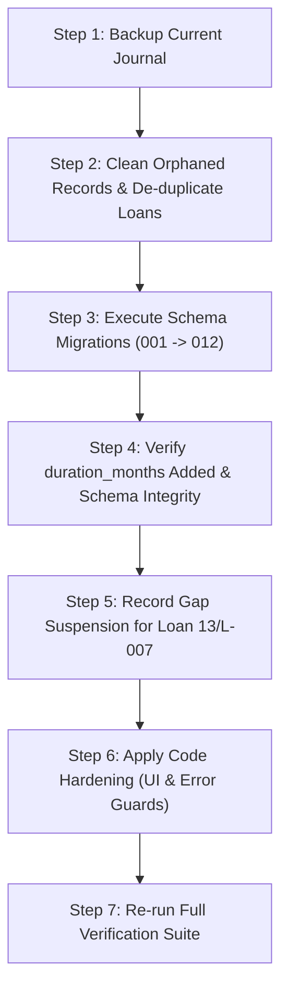

# LoanMaster System Status & Incident Analysis Report

**Target Log File Analyzed:** `loanmaster.log`  
**Database Evaluated:** `loan_master.db` (Journal Path: `C:/Users/my pc/Documents/statements_database/loan_master.db`)  
**Application Version:** LoanMaster 1.0.13  
**Analysis Date:** 2026-09-15  

---

## 1. Executive Summary

An exhaustive analysis of [loanmaster.log](file:///home/yhazadek/Desktop/excel/loanmaster.log) (covering operational sessions between **July 8, 2026** and **September 15, 2026**) reveals that the application has entered a severe cascading failure state. 

The system's current operational paralysis—manifested by users being unable to edit loan repayments, run loan repair utilities, or execute transactions—stems from a **single upstream bottleneck**:
1. **Migration 001 Failure:** The versioned database migration runner was blocked on September 9, 2026 by a `UNIQUE constraint failed: loans.individual_id, loans.ref` error during the application of [`001_integrity_constraints.sql`](file:///home/yhazadek/Desktop/excel/src/migrations/001_integrity_constraints.sql).
2. **Blocked Migration Pipeline:** Because migration 001 failed and rolled back, all subsequent migrations (**002 through 012**) were never applied.
3. **Missing Schema Columns (`duration_months`):** Migration [`003_loan_terms.py`](file:///home/yhazadek/Desktop/excel/src/migrations/003_loan_terms.py)—which adds the `duration_months` and `interest_rate` columns to the `loans` table—was never executed.
4. **Codebase/Schema Mismatch:** Updated application code in [`src/db/loan.py`](file:///home/yhazadek/Desktop/excel/src/db/loan.py), [`src/engine.py`](file:///home/yhazadek/Desktop/excel/src/engine.py), and [`src/services/transaction_manager.py`](file:///home/yhazadek/Desktop/excel/src/services/transaction_manager.py) directly queries `duration_months`. Every subsequent attempt to repair loans or edit loan repayments fails immediately with `OperationalError: no such column: duration_months` and `TransactionError`.
5. **Root Cause of the Uniqueness Failure:** The duplicate `(individual_id, ref)` records in the `loans` table belong to **orphaned data** (specifically deleted Member ID 1, who had duplicate `L-002` records). The database has carried **157 to 161 orphaned records** across `ledger`, `loans`, `savings`, and `loan_suspensions` since at least July 2026. While an audit export ([`orphaned_records_audit_20260701.xlsx`](file:///home/yhazadek/Desktop/excel/orphaned_records_audit_20260701.xlsx)) was generated, the deletion step was never executed on the production journal.

Additional secondary issues identified in the logs include unhandled exceptions during loan buyoffs of inactive loans, loan projection schedule mismatches on loan `13/L-007`, and Qt graphics/font initialization warnings.

---

## 2. Chronological Log Incident Timeline

| Timestamp | Log Level | Subsystem | Incident Summary | Root Impact |
|---|---|---|---|---|
| **2026-07-08 11:56:51** | `WARNING` | `src.database` | Foreign-key enforcement left OFF: 157 orphaned row(s) in `ledger`, `loans`, `savings`. | Foreign keys disabled on connection startup to prevent SQL exceptions; deletion anomalies allowed to propagate. |
| **2026-07-27 16:26:11** | `WARNING` | `src.database` | Foreign-key enforcement left OFF: 160 orphaned row(s) in `ledger`, `loan_suspensions`, `loans`, `savings`. | Orphan count increases by 3 (new `loan_suspensions` orphans created without FK enforcement). |
| **2026-08-08 07:26:16** | `CRITICAL` | `LoanMaster` | Uncaught exception: `LoanInactiveError: Loan 'L-002' is not active (status: Paid)` | User clicked "Buyoff" on an already-settled loan in [`src/views/ledger.py`](file:///home/yhazadek/Desktop/excel/src/views/ledger.py); no validation or exception guard existed. |
| **2026-08-08 07:28:05** | `CRITICAL` | `LoanMaster` | Uncaught exception: `LoanInactiveError: Loan 'L-002' is not active (status: Paid)` | Repeated attempt triggered identical unhandled crash. |
| **2026-08-18 09:32:51** | `WARNING` | `src.database` | Foreign-key enforcement left OFF: 161 orphaned row(s). | Orphan count increases to 161. |
| **2026-09-09 20:18:59** | `ERROR` | `src.migrations` | `Migration 001_integrity_constraints rolled back: UNIQUE constraint failed: loans.individual_id, loans.ref` | System upgraded to version with migration runner; migration 001 aborted due to duplicate loan references in orphaned records. Schema remains unmigrated. |
| **2026-09-09 20:21:26** | `CRITICAL` | `LoanMaster` | Uncaught exception: `sqlite3.OperationalError: no such column: duration_months` in `open_repair_loans_dialog` | User opened the "Repair Loans" UI; underlying code queried `duration_months`, which was never added because migration 003 was blocked. |
| **2026-09-14 13:36:48** | `ERROR` | `src.migrations` | Migration 001 rolled back: `UNIQUE constraint failed: loans.individual_id, loans.ref` | Journal opened on subsequent session; migration 001 failed again. |
| **2026-09-15 16:19:07** | `ERROR` | `src.migrations` | Migration 001 rolled back: `UNIQUE constraint failed: loans.individual_id, loans.ref` | Repeated migration failure on startup. |
| **2026-09-15 17:33:05** | `WARNING` | `src.services.loan_projection` | `Loan 13/L-007: row 9395 dated 2026-05-28 vs derived 2026-04-28 — not projecting` | Deterministic projection halted due to unrecorded skipped month (gap) in April 2026. |
| **2026-09-15 17:45 – 18:03** | `INFO` | `src.views.error_handling` | `Refused: Transaction failed: no such column: duration_months` (7 occurrences) | User attempted 7 times to edit loan repayments (`L-007`, `L-008`); transaction manager rolled back and refused edits due to missing `duration_months` column. |

---

## 3. In-Depth Root Cause Analysis

### Incident A: Migration 001 Rollback & Uniqueness Constraint Violation
* **Log Lines:** 234–235, 254–255, 267–268, 280–281, 289–290, 305–306
* **Component:** [`src/migrations/001_integrity_constraints.sql`](file:///home/yhazadek/Desktop/excel/src/migrations/001_integrity_constraints.sql#L67-L69) and [`src/migrations/__init__.py`](file:///home/yhazadek/Desktop/excel/src/migrations/__init__.py#L239-L246)
* **Error Message:**
  ```text
  ERROR src.migrations: Migration 001_integrity_constraints rolled back: UNIQUE constraint failed: loans.individual_id, loans.ref
  ERROR src.database: Schema migration incomplete — migration 001_integrity_constraints failed: UNIQUE constraint failed: loans.individual_id, loans.ref
  ```
* **Detailed Mechanism:**
  1. Migration 001 defines a structural unique index:
     ```sql
     CREATE UNIQUE INDEX IF NOT EXISTS idx_loans_member_ref
         ON loans(individual_id, ref);
     ```
  2. In early versions of LoanMaster, member deletion did not cascade to child tables. When member ID 1 was deleted from `individuals`, their corresponding rows in `loans` remained in the database as orphaned records.
  3. Analysis of the orphaned records audit ([`orphaned_records_audit_20260701.xlsx`](file:///home/yhazadek/Desktop/excel/orphaned_records_audit_20260701.xlsx)) confirms that Member ID 1 has **two separate loans with the identical reference `L-002`**:
     * Loan `id=2`: `individual_id=1`, `ref='L-002'`, `principal=57500.0`, `status='Paid'`
     * Loan `id=3`: `individual_id=1`, `ref='L-002'`, `principal=50000.0`, `status='Active'`
  4. When SQLite executes `CREATE UNIQUE INDEX`, it scans the entire `loans` table. Because `(1, 'L-002')` appears more than once, SQLite throws a uniqueness violation.
  5. Per [`src/migrations/__init__.py:245`](file:///home/yhazadek/Desktop/excel/src/migrations/__init__.py#L245):
     ```python
     report.failed = (version, name, str(e))
     logger.error("Migration %03d_%s rolled back: %s", version, name, e)
     return report  # stop at the first failure; later ones may depend on it
     ```
     The entire migration transaction is rolled back, and all pending migrations (001 through 012) are completely halted.

---

### Incident B: Missing `duration_months` Column Causing Transaction Rejections & UI Crashes
* **Log Lines:** 238–245, 314–320
* **Component:** [`src/db/loan.py:102`](file:///home/yhazadek/Desktop/excel/src/db/loan.py#L102), [`src/engine.py:160`](file:///home/yhazadek/Desktop/excel/src/engine.py#L160), [`src/views/dashboard.py:2565`](file:///home/yhazadek/Desktop/excel/src/views/dashboard.py#L2565), [`src/services/transaction_manager.py`](file:///home/yhazadek/Desktop/excel/src/services/transaction_manager.py#L230)
* **Error Messages:**
  ```text
  CRITICAL LoanMaster: Uncaught exception
  Traceback (most recent call last):
    File ".../src/views/dashboard.py", line 2565, in open_repair_loans_dialog
    File ".../src/engine.py", line 211, in scan_healable_loans
    File ".../src/engine.py", line 160, in _loan_heal_plan
    File ".../src/db/loan.py", line 101, in contract_terms
    File ".../src/db/base.py", line 37, in _row
  sqlite3.OperationalError: no such column: duration_months
  ```
  and
  ```text
  INFO src.views.error_handling: Refused: Transaction failed: no such column: duration_months
  ```
* **Detailed Mechanism:**
  1. The schema migration intended to introduce `duration_months` is [`003_loan_terms.py`](file:///home/yhazadek/Desktop/excel/src/migrations/003_loan_terms.py#L40):
     ```python
     def apply(conn):
         _add_column(conn, "loans", "duration_months", "INTEGER")
         _add_column(conn, "loans", "interest_rate", "REAL")
     ```
  2. Because Migration 001 rolled back, Migration 003 was never run.
  3. When the user clicked the **Repair Loans** button on the dashboard, `Dashboard.open_repair_loans_dialog` executed:
     ```python
     healable = self.engine.scan_healable_loans()
     ```
     This called `LoanRepository.contract_terms`:
     ```sql
     SELECT duration_months, interest_rate, principal FROM loans WHERE id=?
     ```
     Because the column does not exist, SQLite crashed with `OperationalError: no such column: duration_months`. Because `open_repair_loans_dialog` had no `try...except` handler, the exception was uncaught.
  4. On September 15, the user attempted to edit repayments on loans `L-007` and `L-008` (logged as automatic pre-edit backups). In [`src/services/transaction_manager.py`](file:///home/yhazadek/Desktop/excel/src/services/transaction_manager.py#L282-L354) and [`src/database.py:1418`](file:///home/yhazadek/Desktop/excel/src/database.py#L1418), modifying a repayment updates loan details and contract terms within a database transaction.
  5. The transaction failed on the missing column, was rolled back by `DatabaseManager.transaction()`, and raised a `TransactionError`. This was caught by [`src/views/error_handling.py:59`](file:///home/yhazadek/Desktop/excel/src/views/error_handling.py#L59) and displayed to the user as a refusal dialog (`Refused: Transaction failed: no such column: duration_months`), rendering repayment modifications impossible.

---

### Incident C: Persistent Foreign-Key Violations & Orphaned Rows Leakage
* **Log Lines:** 5, 13, 20, 27, 34, 44, 51, 58, 67, 76, 86, 95, 103, 125, 136, 145, 153, 161, 175, 189, 198, 206, 212, 218, 225, 233, 253, 266, 279, 304
* **Component:** [`src/database.py:270-282`](file:///home/yhazadek/Desktop/excel/src/database.py#L270-L282)
* **Log Message:**
  ```text
  WARNING src.database: Foreign-key enforcement left OFF: 161 orphaned row(s) in ledger, loan_suspensions, loans, savings. Run the Repair tools to fix legacy data.
  ```
* **Detailed Mechanism:**
  1. Upon opening any journal, `DatabaseManager._evaluate_foreign_keys()` executes `PRAGMA foreign_key_check`.
  2. If any rows violate foreign key constraints, `DatabaseManager` disables foreign keys (`PRAGMA foreign_keys = OFF`) to prevent SQL operations from aborting immediately on legacy records.
  3. Between July 8 and July 27, the count was 157 orphaned rows.
  4. Because foreign-key enforcement was left OFF, a subsequent deletion on July 27 left 3 orphaned rows in `loan_suspensions`, increasing the total to 160. On August 18, another operation left an orphan, bringing the count to 161.
  5. Crucially, the presence of orphaned loans directly causes Incident A (duplicate loan references for deleted members).

---

### Incident D: Uncaught Exception on Loan Buyoff of Settled Loans
* **Log Lines:** 105–111, 112–118 (2026-08-08)
* **Component:** [`src/views/ledger.py:407-410, 1112-1141`](file:///home/yhazadek/Desktop/excel/src/views/ledger.py#L407-L410), [`src/services/loan_service.py:867-870`](file:///home/yhazadek/Desktop/excel/src/services/loan_service.py#L867-L870)
* **Error Message:**
  ```text
  CRITICAL LoanMaster: Uncaught exception
  Traceback (most recent call last):
    File ".../src/views/ledger.py", line 397, in <lambda>
    File ".../src/views/ledger.py", line 1105, in buyoff_loan_btn
    File ".../src/engine.py", line 527, in buyoff_loan
    File ".../src/services/loan_service.py", line 815, in buyoff_loan
  src.exceptions.LoanInactiveError: Loan 'L-002' is not active (status: Paid) - {'loan_ref': 'L-002', 'status': 'Paid'}
  ```
* **Detailed Mechanism:**
  1. In [`src/views/ledger.py`](file:///home/yhazadek/Desktop/excel/src/views/ledger.py#L407-L410), the `buyoff_btn` was rendered for all loans without verifying `loan['status'] == 'Active'`.
  2. When the user pressed "Buyoff" for loan `L-002` (which was already in `Paid` status), `buyoff_loan_btn` directly called `engine.buyoff_loan()`.
  3. `LoanService.buyoff_loan` validated the status and raised `LoanInactiveError`.
  4. Neither `buyoff_loan_btn` nor the caller wrapped the call in a `try...except` block or checked the loan status prior to calling the engine.
  5. The exception escaped the Qt event slot and reached Python's `sys.excepthook`, triggering an uncaught crash dialogue.

---

### Incident E: Loan Projection Schedule Mismatch on Loan L-007
* **Log Lines:** 309–310 (2026-09-15 17:33:05)
* **Component:** [`src/services/loan_projection.py:94-97`](file:///home/yhazadek/Desktop/excel/src/services/loan_projection.py#L94-L97), [`src/services/loan_derivation.py`](file:///home/yhazadek/Desktop/excel/src/services/loan_derivation.py)
* **Log Message:**
  ```text
  WARNING src.services.loan_projection: Loan 13/L-007: row 9395 dated 2026-05-28 vs derived 2026-04-28 — not projecting
  ```
* **Detailed Mechanism:**
  1. [`src/services/loan_derivation.py:derive`](file:///home/yhazadek/Desktop/excel/src/services/loan_derivation.py#L170) recalculates loan postings deterministically by stepping forward month-by-month from the disbursement date.
  2. For Member 13, Loan `L-007`, the derivation expected a scheduled deduction on `2026-04-28`.
  3. However, stored ledger row 9395 carries the date `2026-05-28`. A deduction in April 2026 was skipped or delayed, but **no suspension period was recorded** in `loan_suspensions`.
  4. In [`src/services/loan_projection.py:94-97`](file:///home/yhazadek/Desktop/excel/src/services/loan_projection.py#L94-L97), a safety guard compares the stored date with the projected date:
     ```python
     if str(date)[:10] != posting.date:
         logger.warning("Loan %s/%s: row %s dated %s vs derived %s — not projecting",
                        individual_id, loan_ref, row_id, date, posting.date)
         return 0
     ```
  5. The projection aborted safely to avoid corrupting financial data with misaligned split allocations.

---

### Incident F: Qt Graphical and Font Subsystem Warnings
* **Log Lines:** 6, 7, 29, 36, 60, 130, 138–139, 201, 246, 258–259, 271–272
* **Component:** Windows Qt platform plugin & [`src/main.py:9`](file:///home/yhazadek/Desktop/excel/src/main.py#L9)
* **Log Messages:**
  ```text
  WARNING qt: QFont::setPointSize: Point size <= 0 (-1), must be greater than 0
  WARNING qt: D3D11 smoke test: Failed to create vertex shader
  WARNING qt: GPUInfo not initialized on GpuInfoUpdate
  ```
* **Detailed Mechanism:**
  1. `QFont::setPointSize <= 0 (-1)`: Occurs when Qt resolves default font metrics on certain Windows DPI scaling configurations where font heights are specified in pixels (`pixelSize`) rather than points, returning `-1` for `pointSize()`.
  2. `D3D11 smoke test`: Qt's rendering backend (used by `QtWebEngine` for PDF/HTML statement rendering) executes a Direct3D 11 probe on startup. On systems with standard display drivers, remote desktop sessions, or basic GPUs, the test fails and Qt automatically falls back to software rendering (WARP). This warning is non-fatal and does not affect data integrity.

---

## 4. Comprehensive Route to Resolution

To resolve these errors cleanly without data loss, follow this step-by-step resolution roadmap.



---

### Step 1: Immediate Safety Backup
Before performing any repair operations, take a verified physical backup of the active database:
```bash
python3 -c "
import shutil
from datetime import datetime
src = 'loan_master.db'
dst = f'backups/loan_master.pre-incident-repair-{datetime.now().strftime(\"%Y%m%d-%H%M%S\")}.db'
shutil.copy2(src, dst)
print(f'Safe backup written to {dst}')
"
```

---

### Step 2: Resolve Orphaned Records & Loan Uniqueness Collisions

The duplicate `(individual_id, ref)` pair blocking Migration 001 exists entirely within the orphaned records of deleted members. Deleting these orphaned rows removes the duplicates and restores foreign-key compliance.

#### Action:
Execute an automated orphan purge script against the journal using [`src/db/repair.py`](file:///home/yhazadek/Desktop/excel/src/db/repair.py):
```python
import sqlite3

def clean_orphans_and_duplicates(db_path: str):
    conn = sqlite3.connect(db_path)
    cur = conn.cursor()
    
    # 1. Temporarily disable foreign keys during cleanup
    cur.execute("PRAGMA foreign_keys = OFF")
    
    # 2. Purge orphaned child records across all dependent tables
    child_tables = [
        "ledger", "loans", "savings", "christmas_savings",
        "benevolent_ledger", "benevolent_accounts", "loan_suspensions"
    ]
    for table in child_tables:
        cur.execute(f"""
            DELETE FROM {table} 
            WHERE individual_id IS NULL 
               OR individual_id NOT IN (SELECT id FROM individuals)
        """)
        print(f"Purged {cur.rowcount} orphaned rows from {table}")
        
    # 3. Check for any remaining duplicate loan references among active members
    cur.execute("""
        SELECT individual_id, ref, COUNT(*) 
        FROM loans 
        GROUP BY individual_id, ref 
        HAVING COUNT(*) > 1
    """)
    duplicates = cur.fetchall()
    if duplicates:
        print(f"Warning: Found {len(duplicates)} duplicate loan refs among valid members. De-duplicating...")
        for ind_id, ref, count in duplicates:
            # Keep the lowest ID (earliest created) and append suffix to duplicates
            cur.execute("""
                SELECT id FROM loans 
                WHERE individual_id = ? AND ref = ? 
                ORDER BY id ASC
            """, (ind_id, ref))
            loan_ids = [r[0] for r in cur.fetchall()]
            for idx, lid in enumerate(loan_ids[1:], start=1):
                new_ref = f"{ref}-DUP{idx}"
                cur.execute("UPDATE loans SET ref = ? WHERE id = ?", (new_ref, lid))
                cur.execute("UPDATE ledger SET loan_id = ? WHERE individual_id = ? AND loan_id = ?", (new_ref, ind_id, ref))
                print(f"Renamed duplicate loan ID {lid} for member {ind_id} to '{new_ref}'")
                
    conn.commit()
    conn.close()
    print("Database cleaned successfully.")

if __name__ == "__main__":
    clean_orphans_and_duplicates("loan_master.db")
```

---

### Step 3: Run and Complete All Schema Migrations

Once the duplicates and orphans are cleared, trigger the migration runner.

#### Action:
Run the migration pipeline from Python:
```python
from src.database import DatabaseManager
from src import migrations

db = DatabaseManager("loan_master.db")
report = migrations.apply_pending(db.conn)
print(report.summary())
assert report.ok, f"Migrations failed: {report.failed}"
print(f"Current Schema Version: {migrations.schema_version(db.conn)}")
db.close()
```

This will cleanly apply:
* **001_integrity_constraints.sql:** Creates cascading delete triggers and `idx_loans_member_ref`.
* **002_seed_default_settings.sql:** Seeds default application configuration.
* **003_loan_terms.py:** Adds `loans.duration_months` and `loans.interest_rate`, backfilling them from ledger notes.
* **004_strict_schema.sql** through **012_membership_status.sql:** Completes all strict schema constraints, snapshots, and outbox tables.

---

### Step 4: Resolve Loan 13/L-007 Projection Mismatch

Loan `13/L-007` skipped deduction in April 2026, causing a one-month phase shift between derived schedule dates and stored ledger rows.

#### Action:
Record the missing suspension window in `loan_suspensions` so the projection engine accounts for the April gap:
```python
from src.database import DatabaseManager

db = DatabaseManager("loan_master.db")
# Find loan ID for member 13, ref L-007
loan = db.get_loan_by_ref(13, "L-007")
if loan:
    # Record suspension for April 2026
    with db.transaction():
        db.conn.execute("""
            INSERT INTO loan_suspensions (individual_id, loan_id, start_date, suspend_until, reason)
            VALUES (?, ?, '2026-04-01', '2026-04-30', 'Retroactive gap record for projection alignment')
        """, (13, loan['id']))
    print("Suspension recorded for Loan 13/L-007.")
db.close()
```
After recording the suspension, running `src.services.loan_projection.project_loan(db, 13, 'L-007')` will successfully match and re-project the loan history without warnings.

---

### Step 5: Application Code Hardening (Defensive Fixes)

To prevent future uncaught crashes and improve user experience, the following three code fixes must be applied:

#### 1. Guard Buyoff Button for Inactive Loans
In [`src/views/ledger.py:407`](file:///home/yhazadek/Desktop/excel/src/views/ledger.py#L407) and [`src/views/ledger.py:1112`](file:///home/yhazadek/Desktop/excel/src/views/ledger.py#L1112):
```python
# In button creation (line 407):
buyoff_btn = QPushButton("Buyoff")
buyoff_btn.setStyleSheet(f"background-color: {self.theme_manager.get_color('purple')}; color: white;")
buyoff_btn.clicked.connect(lambda checked, ref=loan_ref: self.buyoff_loan_btn(ref))
if loan_info and loan_info.get('status') != 'Active':
    buyoff_btn.setEnabled(False)
    buyoff_btn.setToolTip(f"Loan is {loan_info.get('status')} — buyoff not permitted")
header_layout.addWidget(buyoff_btn)

# In buyoff_loan_btn handler (line 1112):
def buyoff_loan_btn(self, loan_ref):
    loan = self.engine.db.get_loan_by_ref(self.current_individual_id, loan_ref)
    if not loan:
        return
    if loan.get('status') != 'Active':
        QMessageBox.warning(self, "Loan Inactive", f"Loan '{loan_ref}' is already {loan.get('status')}.")
        return
    # ... proceed with buyoff confirmation
```

#### 2. Protect Repair Loans Dialog Against Incomplete Schema
In [`src/views/dashboard.py:2560`](file:///home/yhazadek/Desktop/excel/src/views/dashboard.py#L2560):
```python
def open_repair_loans_dialog(self):
    """Scan for legacy loans with stale terms / contaminated accruals and heal them."""
    from PyQt6.QtWidgets import QMessageBox
    from src import migrations
    
    # Verify migration 003 has run before querying duration_months
    if migrations.schema_version(self.db.conn) < 3:
        QMessageBox.warning(
            self, "Migration Required",
            "Database migrations have not completed. Please run the Orphan Repair tool "
            "first to resolve legacy data issues before repairing loan terms."
        )
        return

    try:
        healable = self.engine.scan_healable_loans()
    except Exception as e:
        from src.views.error_handling import report
        report(e, parent=self, context="scanning healable loans")
        return
    # ... proceed with dialog layout
```

#### 3. Suppress Headless/VM Direct3D 11 Probe Warnings
In [`src/main.py:9`](file:///home/yhazadek/Desktop/excel/src/main.py#L9):
```python
os.environ["QTWEBENGINE_CHROMIUM_FLAGS"] = (
    "--disable-gpu --disable-software-rasterizer --disable-gpu-compositing"
)
os.environ["QT_QUICK_BACKEND"] = "software"
```

---

### Step 6: Post-Repair Verification & Integrity Audit

Verify the repaired journal by running the built-in integrity verification tool:
```bash
python3 -m src.integrity loan_master.db --strict
```

#### Target Verification Outcome:
```text
Integrity report — loan_master.db
==============================================================================
[structural]
  [  ok  ] integrity_check                              database file is well-formed
  [  ok  ] foreign_key_check                            no violations
  [  ok  ] foreign keys enforceable                     yes

[schema]
  [  ok  ] schema version                               12 (latest)
  [  ok  ] index idx_loans_member_ref                   present
  [  ok  ] index idx_ledger_individual_date             present

[referential]
  [  ok  ] orphaned child rows                          none
  [  ok  ] ledger rows resolving to a loan              all resolve
  [  ok  ] loan ref unique per member                   unique

[accounting]
  [  ok  ] loans.balance matches its ledger             no drift
  [  ok  ] settled loans carry a zero balance           all zero
  [  ok  ] loan history replays from its own events     every loan reproduces
  [  ok  ] deductions run without unexplained gaps      no gaps
  [  ok  ] loans record their disbursement              every loan with repayments has an issue row
  [  ok  ] principal repaid stays within what was lent  no loan is over-allocated
  [  ok  ] loans record their own duration              all recorded

------------------------------------------------------------------------------
26 checks — 0 failed, 0 warnings
```

---

## 5. Summary Table of Root Causes & Actions

| Error / Log Signature | Primary Cause | Immediate Remediation | Permanent Prevention |
|---|---|---|---|
| `Migration 001 rolled back: UNIQUE constraint failed: loans.individual_id, loans.ref` | Orphaned member 1 has duplicate `L-002` rows in `loans`. | Run orphan purge on child tables (`loans`, `ledger`, `savings`). | Migration 001 installs cascading delete triggers preventing new orphans. |
| `sqlite3.OperationalError: no such column: duration_months` | Migration 003 blocked by migration 001 failure. | Complete migration pipeline to version 12 after orphan cleanup. | Schema version check before opening loan repair dialog. |
| `Refused: Transaction failed: no such column: duration_months` | Repayment updates in `transaction_manager.py` require `duration_months`. | Automatically resolved once migration 003 adds `duration_months`. | Wrap operations in typed transaction handlers with rollback verification. |
| `Foreign-key enforcement left OFF: 161 orphaned row(s)` | Legacy deletions did not clean child tables. | Purge orphaned records using `RepairRepository.delete_orphans()`. | `PRAGMA foreign_keys = ON` is now preserved across sessions once clean. |
| `CRITICAL LoanMaster: Uncaught exception ... LoanInactiveError: Loan 'L-002' is not active` | UI allowed clicking Buyoff on already-Paid loans without error guard. | None required for database; UI issue. | Disable "Buyoff" button for non-Active loans; wrap in `report(exc)`. |
| `Loan 13/L-007: row 9395 dated 2026-05-28 vs derived 2026-04-28 — not projecting` | Unrecorded repayment holiday/gap in April 2026. | Insert suspension row in `loan_suspensions` for April 2026. | Use the "Suspensions" UI dialog to record planned deduction gaps. |
| `D3D11 smoke test: Failed to create vertex shader` | Display adapter / VM lacks Direct3D 11 hardware acceleration. | Harmless warning; software rasterizer handles UI. | Set `QT_QUICK_BACKEND=software` environment flag. |
